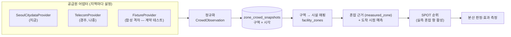

# 서울 테스트베드 — 실시간 유동인구 기반 시스템 사전 구축·검증 계획

> 상태: **진행 중(2026-10-31) — S0·S1·S2·S5·S6 완료(`yunseong`, main 미반영), S3·S4 는 사용자가 직접 진행(대기)**. 진행표는 §6 끝. 같은 날 앞선 판('현재 이해' 정리)은 git 이력에 있다(`e5703d6`).
> 앞선 계획은 [`CONGESTION_ENGINE_PLAN.md`](./CONGESTION_ENGINE_PLAN.md)(D1~D6 결정 완료·구현됨)이고, 전체 방향은 [`PRODUCT_EVALUATION_PLAN.md`](./PRODUCT_EVALUATION_PLAN.md) §0 이다.
> 표기: **[확인]** 코드·문서·git 에서 직접 본 것 · **[추정]** 근거로 미루어 판단한 것 · **[제안]** 이 문서가 새로 내놓는 설계(승인 전).

## 0. 요구사항(사용자, 2026-10-31)

1. **서비스 지역은 경주다.** 앱의 목표 지역은 바뀌지 않는다.
2. **경주의 실시간 유동인구 데이터는 지금 얻기 어렵다.** 통신사 데이터는 사업자금을 들여 나중에 확보한다.
3. **서울은 이미 공공 API(서울 실시간 도시데이터)를 준다.** 서울로 시스템을 **미리 구축하고 검증**한다.
4. **경주 통신사 데이터가 들어오면 앱이 바로 작동해야 한다.**
5. 공모전이 끝나 공공기관 API 의존 의무는 사라졌다. 데이터는 목적에 맞게 고르되 라이선스는 지킨다.

**이 계획의 성공 기준**[제안] — §4 합격 기준이 숫자를 정한다.
- **G1 엔드투엔드**: 서울 데이터로 수집 → 정규화 → 구역 혼잡 → 도착 시점 예측 → 추천 순위 → 분산 판정이 끝까지 돈다.
- **G2 결정 품질**: 실측이 있을 때 추천이 기준선(머물기·가장 가까운 곳·무작위)보다 도착 시점에 덜 붐비는 곳을 고른다는 것을 신뢰구간과 함께 보인다.
- **G3 전환 준비**: 경주 통신사 데이터는 **어댑터 1개 + 구역 정의 + 설정**만으로 켜진다. 추천 엔진·화면 코드는 바꾸지 않는다.
- **G4 데이터 계약**: 통신사에 요구할 명세(해상도·지연·필드·라이선스·이력)가 문서로 있다. 사업자금을 넣는 순간 바로 견적·협상에 쓸 수 있다.

## 1. 이전 판과 무엇이 달라지나

| | 이전(09-20 계획 · 10-31 앞선 판) | 이번 판 |
|---|---|---|
| 서울의 역할 | 경주용 **추정기**(주차 → 인파)를 검증하는 곳 | 실측 유동인구가 있을 때의 **본 시스템**을 미리 만들고 검증하는 리허설 지역 |
| 핵심 산출물 | 추정 정확도 지표 7개 · 보정 곡선 | 데이터 공급원 추상화 · 구역 모델 · 실측 기반 순위 · 분산 결정 재생 평가 · 통신사 데이터 계약 명세 |
| 경주와의 관계 | 서울에서 보정한 곡선을 경주 추정에 옮긴다 | 경주는 통신사 데이터가 들어오면 같은 시스템에 **공급원만 바꿔 끼운다**. 추정 모드는 그 전까지의 폴백 |
| 관광객 앱 서울 모드 | 하지 않는다(D3-B) | 공개는 하지 않는다. **내부(관리자·개발자) 검증용 서울 지역 팩**은 둔다(§7 Q1) |

추정기 검증(지표 7개·보정)은 버리지 않는다. 경주 출시 초기, 통신사 데이터 전의 폴백 품질을 설명하는 근거로 남긴다.

## 2. 지금 있는 것 (코드 기준 [확인])

| 기능 | 위치 | 상태 |
|---|---|---|
| 서울 수집기(조회·파싱·대상지명 대조·주차 필터·추정·저장) | `apps/api/app/services/seoul_citydata_service.py` | 구현, 테스트 30 |
| 수집·상태 API | `routers/engine_validation.py` — `POST /api/v1/engine-validation/seoul/collect`(기계·관리자), `GET …/seoul/status` | 구현 |
| 저장 | `seoul_citydata_snapshots`(대상지·10분 버킷 유니크, service_role 만) — `20260920120000` | 운영 적재 중 — 09-20 23:40 KST 부터 5곳 10분(S0 A) |
| 스케줄 | pg_cron 10분 + 보충(`20260920121000`), 보충 예산(`20260920140000`) | **둘 다 적용됨**(S0 C — 보충 `9,39 * * * *`). 수집 호스트는 Render 싱가포르 API(S0 D) |
| 혼잡 공급원 층(S1) | `services/crowd/` — `CrowdObservation`·`CrowdProvider`·`seoul_provider`·`store`·`telecom_template` | 구현(`b6cb50a`·`20096dd`). 수집기가 저장한 대상지를 `zone_crowd_snapshots` 에도 저장(이중 저장) |
| 구역 표(S1) | `zones`·`zone_crowd_snapshots`·`facility_zones` — `20261031120000`(RLS, service_role 전용) | 원격 적용 대기(사람 작업). 없으면 수집은 그대로, 이중 저장만 상태에 남긴다 |
| 추정 정확도 지표·판정 | `services/engine_validation_metrics.py` | 구현 |
| 보정(주차 → 인파 곡선, 관문 통과 시 경주 추정에 자동 적용) | `services/congestion_calibration_service.py`, `congestion_estimator_service.py:178-187` | 구현 |
| 대안 패널(홍대 → 연남동·합정, SPOT 미사용) | `services/seoul_alternatives_service.py` | 구현(시연용) |
| 관리자 화면 | `apps/web/app/admin/engine-validation/page.tsx` | '실시간 데이터 리허설'(S6, 옛 '엔진 검증'), 메뉴에서 숨김(`AdminSidebar.tsx` `HIDDEN_FROM_MENU`) |

- 쓰는 필드는 다음과 같다.
  - `LIVE_PPLTN_STTS`: `AREA_CONGEST_LVL`(4단계 정답), `AREA_PPLTN_MIN/MAX`, `PPLTN_TIME`, `FCST_PPLTN`(서울시 예측)
  - `PRK_STTS`: 주차장
- 호출은 대상지 1곳에 1회씩이고, 일 1,000회 한도다. 이력 API 는 없다. 공공누리 제1유형이다. [확인]
- **운영 수집은 돈다(S0, 사용자가 SQL A~E 실행 — 결과는 §7 표).** [확인]
- **S0 결과 해석(Claude, A~D)** — E 는 §7 'A8 해석'에 있다.
  - A: 5곳 모두 09-20 23:40 KST ~ 10-31 16:30 KST, 곳마다 5,825~5,829행이다. 차례였던 버킷 5,862개 대비 **약 99.4%** 다.
  - B: 거의 모든 날이 144/일이다. 크게 빈 날은 09-26(122)·09-27(136)뿐이고 5곳이 같은 수만큼 비었다 — 대상지 문제가 아니라 수집 쪽(호출·호스트)이 멈춘 시간으로 본다 [추정]. 최근 2주는 §4 V1(채움률 ≥ 98%)을 넘는다.
  - C: 보충 예약이 `9,39 * * * *` 다 → `20260920140000` 적용됨. 이 가정 위에서 S2 호출 예산(최악 864회/일)을 셌다.
  - D: 수집 URL 호스트가 싱가포르 `nextspot-t2ib.onrender.com`(10-09 교체)이다. 수집은 Render API 를 거친다 — API 가 멈추면 서울 수집도 멈춘다.
  - 뜻: 홍대 권역 3곳(주차 0 — 실측만)과 명동·동대문은 **40일치 실측**이 이미 있다(S4 재생 평가 재료). 종로 4곳은 S2 배포 뒤부터 쌓인다(2~4주).

## 3. 목표 아키텍처 [제안]

공급원(서울 공공 API · 경주 통신사)이 무엇이든, 추천 엔진은 **정규화된 '구역 혼잡 관측'** 하나만 본다.



**3.1 공급원 인터페이스**
- `fetch_current(zones) -> list[CrowdObservation]`
- `fetch_forecast(zones, horizon) -> list[CrowdForecast]` (선택)
- `describe() -> 주기·지연·해상도·라이선스`
- 실패는 예외가 아니라 '관측 없음'으로 돌려준다.
- 지금 수집기의 조회·파싱 로직은 `SeoulCitydataProvider` 로 옮기고, 수집 경로·표는 유지한다.

**3.2 정규화 스키마 `CrowdObservation`**

| 필드 | 뜻 | 서울 | 경주 통신사(예상) |
|---|---|---|---|
| `zone_id` | 구역 | 주요 장소 코드(POI007 등) | 격자 셀 ID · 집계구 |
| `observed_at` · `period` | 관측 시각 · 집계 단위 | `PPLTN_TIME` · 약 5~10분 | 계약에 따라(목표 ≤10분) |
| `population` (min/max/point) | 인원 추정 | `AREA_PPLTN_MIN/MAX` | 셀 인원 추정 |
| `level` · `level_scale` | 0~1 정규화 + 원래 단계 | `AREA_CONGEST_LVL` 4단계 | 기준선 대비로 산출(§3.5) |
| `forecast[]` | 대상 시각별 예측 | `FCST_PPLTN` | 제공되면 사용, 아니면 자체 예측 |
| `source` · `quality` | 공급원 · 표본/결측/지연 플래그 | | |

**3.3 구역(zone) 모델**
- 테이블은 `zones(zone_id, region, kind, name, geometry, centroid)` 이다. `kind` 는 `hotspot_polygon` | `grid_cell` | `admin_area` 중 하나다.
- 서울 주요 장소의 영역 경계는 서울시가 공간 데이터로 따로 공개한다(주요 121장소 영역 파일 — S1 의 9곳 시드는 그 다각형의 넓이 중심이다). 경주는 통신사 격자를 그대로 쓴다.
- **해상도가 핵심이다.**
  - 서울 주요 장소는 '권역' 단위라, 같은 권역 안의 가게들은 같은 값을 받는다. 그래서 서울로는 **권역 간 분산**(홍대 → 연남동)을 검증한다.
  - 황리단길 안의 골목을 구별하려면 경주 데이터는 **100~250m 격자 이하**여야 한다. 이 요구는 §5 계약 명세에 넣는다.

**3.4 시설 → 구역 매핑 `facility_zones(facility_id, zone_id, method, weight)`**
- 점-다각형 포함, 또는 가장 가까운 격자로 매핑한다.
- 밤 배치로 미리 계산한다. 시설·구역이 바뀌면 다시 돈다.

**3.5 구역 혼잡을 추천에 넣기**
- 새 근거 등급은 `measured_zone`(공급원 실측)이다.
  - 신선도 30분 안이면 `measured_rules` 경로로 순위에 들어간다.
  - 지금 경주의 '추정'(혼잡 항 영향 ≤ 약 0.05)과 달리, **혼잡이 후보를 실제로 구별**하게 된다.
- 통신사 인원 → 0~1 단계 환산은 **구역별 기준선**(같은 요일·시간대 분포의 분위수)으로 한다. 기준선이 쌓이기 전에는 공급원 단계 또는 보수적 절대 임계값을 쓰고, 그 사실을 표시한다.
- 도착 시점 예측은 이 순서로 고른다.
  1. 공급원 예측(`FCST_PPLTN` 등)
  2. 자체 모델(이력이 쌓인 뒤 학습)
  3. 지속성(현재값 유지, 30분 이내만)
- 순서마다 라벨을 붙인다.
- 재배치기여 항(`score.py` relief)이 실측 근거에서도 켜지도록 확인한다. 지금은 모델 예측이 있을 때만 켜진다(`score.py:228-236`).

**3.6 지역 팩**
- 웹 `apps/web/lib/region.ts`(중심·경계·프리셋)와 API 지역 설정(공급원·구역 출처·POI 출처)을 한 묶음으로 둔다.
- **서울 팩은 내부 검증용이다.** 관리자·개발자에게만 열고 관광객에게는 노출하지 않는다.
- 서울 POI 는 TourAPI 서울 지역 적재로 채운다. 카카오 로컬 영속 적재는 약관 위험으로 이미 접은 길이다(`archive/KAKAO_LOCAL_EXPANSION.md`).

## 4. 검증 계획 — 서울이 증명할 것 [제안]

| # | 무엇을 | 방법 | 합격 기준(제안 — §7 Q3 에서 확정) |
|---|---|---|---|
| V1 | 파이프라인 신뢰성 | 수집 성공률·결측 버킷·관측→반영 지연을 대상지별로 매일 집계 | 7일 연속 버킷 채움률 ≥ 98%, 지연 중앙값 ≤ 15분 |
| V2 | 실측이 순위를 움직이는가 | 같은 후보 집합에서 실측 혼잡을 넣고 뺀 순위 비교(민감도) | 실측이 있을 때 1위가 바뀌는 비율과 점수 영향 분포를 보고(경주 추정 ≤0.05 와 대비) |
| V3 | **분산 결정 품질(핵심)** | **분산 결정 재생**(아래) | 추천지가 도착 시 ≥1단계 덜 붐빌 확률이 '가장 가까운 곳' 기준선보다 ≥ 10%p 높고, 일 블록 부트스트랩 95% CI 하한 > 0 |
| V4 | 도착 시점 예측 | 공급원 예측 · 자체 모델 · 지속성의 10~60분 오차 비교 | 30분 예측 MAE 가 지속성보다 낮음(아니면 지속성 사용) |
| V5 | 장애 대응 | 공급원 정지·지연·이상값을 주입해 폴백과 화면 라벨 확인 | 근거 없는 '정상' 표시 0건, 폴백 전환 ≤ 1 수집 주기 |
| V6 | 추정 모드 폴백 품질 | 기존 추정 정확도 지표(명동·동대문) | 기존 판정 기준 유지 — 경주 출시 초기 폴백의 근거 |

**분산 결정 재생(V3)**
1. 수집된 서울 실측을 시각 순서대로 다시 흘린다.
2. 각 10분 버킷 t, 출발 권역 o 마다 실제 추천 경로(SPOT — 취향 중립·쿠폰 0·이동시간은 권역 간 실제 보행/대중교통 추정)로 대안 r 을 고른다.
3. 도착 시점 t+이동시간의 **실측**으로 채점한다.
4. 기준선(머물기 · 가장 가까운 권역 · 무작위 · 오라클)과 비교한다.

- 지표: 기회율(출발지가 붐비고 덜 붐비는 이웃이 있는 비율), 적중률, 단계 차, 오라클 대비 손실, 피한 대기(모델 — 라벨 명시).
- 신뢰구간: 10분 버킷끼리 강하게 상관돼 있으므로 일 단위 블록 부트스트랩으로 낸다.
- 한계(문서에 고정)
  - 서울에는 우리 사용자가 없어 **행동 변화·혼잡 감소는 재지 못한다.** '한 사람이 옮겨도 혼잡은 변하지 않는다'는 가정 아래의 결정 품질이다.
  - 혼잡 감소는 경주 파일럿에서 잰다. 방법은 `PRODUCT_EVALUATION_PLAN.md` P3-1 의 스위치백 또는 이중차분이다.

## 5. 경주 전환 준비 — 통신사 데이터 계약 명세(초안) [제안]

사업자금을 들여 데이터를 살 때, 아래 항목을 견적·계약 요청서로 바로 쓴다. 확정값은 비용과 함께 §7 Q6 에서 정한다.

| 항목 | 요구(초안) | 이유 |
|---|---|---|
| 공간 해상도 | **50m 격자 목표**, 최소 250m 이하(황리단길 반경 2km 전 격자) | 골목 단위로 후보를 구별해야 분산이 된다. 작은 칸은 칸마다 오차가 커서 구역으로 묶어 쓴다(§7 A6) |
| 시간 해상도 · 지연 | 10분 집계, 관측→수신 ≤ 15분 | 도착 시점(도보 5~20분) 판단 |
| 지표 | 체류 인구 추정치(내·외국인 구분이면 더 좋음), 신뢰 구간 또는 표본 플래그 | 단계 산출과 '모름' 표시 |
| 예측 | 있으면 1~3시간 예측 | 없으면 자체 모델(이력 필요) |
| 이력 | 계약 시작 전 최소 8주 백필 | 구역별 기준선·예측 모델 학습 |
| 제공 방식 | API(pull) 또는 주기 파일, 가용성 SLA | 수집기·경보 설계 |
| 라이선스 | 상업 서비스 화면 표시·파생 지표·B2G 리포트 사용 허용 | 앱·관제·보고서 모두 쓴다 |
| 개인정보 | 집계·가명 기준(최소 인원 마스킹) 명시 | 위치정보법·개인정보 검토(평가 문서 P3-5) |

- 후보(가격·조건 확인 필요)
  - 통신 3사의 유동인구 데이터 상품(예: SKT '지오비전 퍼즐' 등)
  - 경상북도·경주시 빅데이터 협력
  - 한국관광공사 데이터랩(집중률 — 이미 사용 중, 상대지수라 단독으로는 부족)
- **공급사에 보낼 요구 명세는 [`CROWD_DATA_CONTRACT.md`](./CROWD_DATA_CONTRACT.md)** 다(S5 — 위 표를 견적·계약 요청서 꼴로 풀고, 공급사에 물을 질문과 `CrowdObservation` 필드 대응표를 더했다). 가격·실제 주기·SLA 는 지어내지 않고 '견적에서 확인'으로 둔다.
- **전환 키트**(S5, `20096dd` 완료): 합성 격자 픽스처, 어댑터 템플릿(`services/crowd/telecom_template.py` — 수집·엔드포인트에 아직 연결하지 않음)과 공급원 계약 테스트, 전환 체크리스트로 구성한다.
- 남은 결정(체크리스트 6단계·S3): 인원 → 단계 분위수를 '평소 대비'(같은 구역·요일·시간대 기준선)로 둘지 '절대 붐빔'으로 둘지, 기준선이 쌓이기 전 잠정 임계값.
  - 공급원 샘플 데이터를 받는 즉시 어댑터를 검증할 수 있게 만든다.
  - 체크리스트: 구역 적재 → 시설 매핑 → 어댑터 → 설정 전환 → 기준선 2주 축적 → 단계 임계값 확정 → 모니터링.

## 6. 구현 단계 [제안]

| 단계            | 범위                                                                                                                 | 증명·산출                | 규모             |
| ------------- | ------------------------------------------------------------------------------------------------------------------ | -------------------- | -------------- |
| S0 확인(사람)     | 운영 서울 수집 점검 SQL A~E 실행, Render `SEOUL_OPENDATA_KEY`·Vault 수집 URL 호스트 확인, `20260920140000` 적용                       | 데이터가 어느 대상지에 며칠치 있는지 | 0.5일           |
| S1 데이터 계층 일반화 | 공급원 인터페이스 + `CrowdObservation` + 서울 어댑터 이전, `zones`·`zone_crowd_snapshots`·`facility_zones` 마이그레이션(원격 적용은 사람), 테스트 | G3 의 뼈대              | 2~3일           |
| S1 질문         | 규모가 2~3일로 적혀있는데 작업량이 그렇게 많아? 몇 시간 정도 자율진행 맡겨놓으면 완료되는거 아냐? 그리고 G1, G2, G3, G4는 무슨 의미야?                              |                      |                |
| S1 답(Claude) | 맞다 — 표의 일수는 사람 개발자 기준이었다. 에이전트가 맡으면 S1 코드·테스트는 **3~5시간**(검토 1회 포함)이다. 다만 어젯밤 영업시간 해석처럼 독립 검증에서 고칠 것이 나오면 한두 번 더 돈다(그때는 코드 1~2시간, 검증·수정 6회로 반나절 넘게 걸렸다). 줄지 않는 것은 사람·외부 몫이다: 마이그레이션 원격 적용(SQL Editor), 수집 기간(S2 2~4주), 한도 상향 승인. 그래서 실제 일정을 정하는 것은 **S2 수집**이다 — 대상지를 먼저 정해 수집을 시작하고, S1·S3 는 그동안 만든다(표 아래 '에이전트 기준 규모').<br>**G1~G4 는 이 계획의 목표 네 개다(§1).** G1 엔드투엔드 = 서울 실데이터가 수집부터 추천·분산 판정까지 끝까지 흐른다. G2 결정 품질 = 그 추천이 '그냥 있기·가장 가까운 곳·무작위'보다 도착했을 때 덜 붐비는 곳을 고른다는 것을 숫자(신뢰구간)로 보인다. G3 전환 준비 = 경주 통신사 데이터는 어댑터 1개 + 구역 정의 + 설정만 바꾸면 켜진다. G4 데이터 계약 = 통신사에 낼 요구 명세(§5)가 문서로 준비돼 있다. | | |
| S2 서울 대상지 재설계 | 경주와 닮은 종로 유산 권역 + 홍대 권역, 호출 한도 계획(아래)                                                                              | 권역 간 대안이 성립하는 표본     | 0.5일 + 수집 2~4주 |
| S3 엔진 연결      | `measured_zone` 근거, 도착 시점 예측 순서, 재배치 기여 항 확인, 서울 지역 팩(내부 전용)                                                       | G1 엔드투엔드             | 3~4일           |
| S4 재생 평가      | 순수 함수 + `apps/api/scripts/crowd_dispersion_replay.py` + 테스트 + 보고(V2~V4)                                            | G2 결정 품질             | 2~3일           |
| S5 경주 전환 키트   | 계약 명세 문서 확정, 합성 격자 픽스처, 어댑터 템플릿·계약 테스트, 체크리스트                                                                      | G3·G4                | 1~2일           |
| S6 관리자 화면     | '엔진 검증'을 '실시간 데이터 리허설'로 재구성. 수집 상태를 사실대로(`not_migrated`·`empty` 를 '가동 중'으로 보이지 않게), 결정 품질·예측 오차                    | 운영자가 상태를 안다          | 1~2일           |

**에이전트 기준 규모(2026-10-31 답)** — S1 3~5시간 · S2 설정 1시간 + 수집 2~4주(줄일 수 없음) · S3 1~2일(A1 로 서울을 내부 전용 서비스 지역으로 넓혀서 커짐) · S4 3~5시간 · S5 2~3시간 · S6 3~5시간. 각 단계 뒤 검토 에이전트 1~2회와 CI 를 포함한 값이다. 사람 작업(마이그레이션 원격 적용·한도 신청)은 따로다.

**진행(2026-10-31, `yunseong` — main 미반영)**

| 단계 | 상태 | 커밋 · 남은 것 |
|---|---|---|
| S0 | ✅ 완료(사용자) | SQL A~E 결과는 §7 표, 해석은 §2. `20260920121000`·`140000` 적용 확인 |
| S1 | ✅ 구현 | `b6cb50a` · 수집 마감 `4052f68`. 남은 것: `20261031120000` 원격 적용(사람) |
| S2 | ✅ 설정 | `b6cb50a` → 주기 재설계 `c534783`(아래). 남은 것: Render `SEOUL_CITYDATA_TARGETS` 정리 · 종로 4곳 이름 확인 · API 배포 뒤 수집 2~4주 |
| S3 | ⏸ 대기 | 사용자가 직접 진행(ultracode) |
| S4 | ⏸ 대기 | 사용자가 직접 진행(ultracode) |
| S5 | ✅ 구현 | `20096dd` · 어댑터 틀 보정 `22ecc1d`. 남은 결정은 §5 |
| S6 | ✅ 구현 | `65a45ff` · `8c0de61`. 결정 품질은 S4 전까지 '아직 없음'(`not_evaluated`) |

**S2 대상지·주기(확정 — `b6cb50a`, 주기는 `c534783`)**
- **종로 유산 권역** 4곳: 경복궁 · 북촌한옥마을 · 인사동 · 창덕궁·종묘(§7 A2 답 — 처음 제안의 광화문·덕수궁 · 서촌은 뺐다).
  - 한옥·유산·카페 골목이 걸어서 이어진다. 황리단길(대릉원·첨성대·한옥 카페)과 가장 닮은 구조다.
  - '인사동·익선동'은 서울시 공식 장소 목록에 한 곳으로 없다(인사동 POI078 · 익선동 POI116). 넓은 인사동으로 정했다 — **사용자 확인 필요**.
  - 이름은 API 대상지명과 글자까지 같아야 한다(다르면 `seoul_area_mismatch`). 배포 전에 4곳을 한 번씩 불러 확인한다(HANDOVER "사람 작업 대기").
- **홍대 권역**(유지): 홍대 관광특구 · 연남동 · 합정역. **추정 폴백 검증**(유지): 명동 · 동대문(주차 신호 있음).
- **주기**: 수집은 그대로 10분 버킷이다. 대상지마다 부를 버킷을 설정 한 줄로 쓴다 — `이름@N+P` 는 버킷 번호 n 이 `n % N == P` 일 때 부른다(표기가 없으면 매 버킷).

| 묶음 | 표기 | 부르는 버킷 | 호출/일 |
|---|---|---|---|
| 홍대 권역 3곳 | (없음) | 매 10분 | 3 × 144 = 432 |
| 종로 4곳 | `@3+1` | :10 · :40 | 4 × 48 = 192 |
| 명동·동대문 | `@3+2` | :20 · :50 | 2 × 48 = 96 |
| 주 호출 합계 | | | **720** |
| 보충 최악(`9,39` — :00·:30 버킷이 비었을 때만) | | 그 버킷 차례는 홍대 3곳뿐 | + 3 × 48 = 144 → **864**(한도 1,000) |

- **왜 이 주기인가**: 처음(`b6cb50a`)에는 홍대 20분(짝수 버킷) · 종로 20분(홀수) · 검증 30분이었다(주 600 · 최악 768). 그런데 20분 주기 대상지는 30분 전망 지표(t ↔ t+30)가 영원히 짝을 못 찾는다 — 유일한 전망 검증지였던 홍대도 그랬다. 그래서 모든 주기를 30분의 약수(10·30분)로 바꿨다.
- 지표 최소 표본 36 버킷은 10분 대상지 6시간, 30분 대상지 18시간이다.
- 익선동을 종로와 같은 `@3+1` 로 10번째에 더해도 주 768 · 최악 912회/일로 한도 안이다(:00·:30 차례가 아니라 보충 최악은 늘지 않는다).
- 실행 시간: 서울 조회는 최대 4곳 동시, 조회 마감 45초 · 실행 전체 80초다(pg_cron 요청 제한 90초 안 — `c534783`·`4052f68`).
- 설정이 틀리면 추측하지 않는다. 빈 값은 503 `seoul_targets_missing`(코드 기본값을 쓰려면 변수를 **지운다**), 잘못된 표기나 같은 이름의 다른 주기는 503 `seoul_targets_invalid`.
- S0 쿼리 B 의 정상값도 바뀐다: 홍대 권역 144/일, 종로·명동·동대문 48/일.

**원칙**
- 운영 DB 는 읽기만 한다(평가 스크립트는 service_role 읽기 또는 CSV 반출).
- `score.py` 가중치(0.40/0.40/0.20)는 바꾸지 않는다.
- 새 표·함수는 마이그레이션 + `build_reset.mjs` PRELUDE 에 넣고, 원격 적용은 사람이 SQL Editor 에서 한다.

## 7. 결정·확인이 필요한 것

| #             | 질문                     | 권장                                                                                                                                                                                                                                                                                                                                                                                                                                                                                                                                                                                                                                                                                                                                                                                                                                                                                                                                                                                                                                                                                                                                                                                                                                                                                                                                                                                                                                                                                                                                                                                                                                                                                                                                                                                                                                                                                                                                                                                                                                                                                                                                                                                                                                                                                                                                                                                                                                                                                                                                                                                                                                                                                                                                                                                                                                                                                                                                                                                                                                                                                                                                                                                                                                                                                                                                                                                                                                                                                                                                                                                                                                                                                                                                                                                                                                                                                                                                                                                                                                                                                                                                                                                                                                                                                                                                                                                                                                                                                                                                                                                                                                                                                                                                                                                                                                                                                                                                                                                                                                                                                                                                                                                                                                                                                                                                                                                  |
| ------------- | ---------------------- | ----------------------------------------------------------------------------------------------------------------------------------------------------------------------------------------------------------------------------------------------------------------------------------------------------------------------------------------------------------------------------------------------------------------------------------------------------------------------------------------------------------------------------------------------------------------------------------------------------------------------------------------------------------------------------------------------------------------------------------------------------------------------------------------------------------------------------------------------------------------------------------------------------------------------------------------------------------------------------------------------------------------------------------------------------------------------------------------------------------------------------------------------------------------------------------------------------------------------------------------------------------------------------------------------------------------------------------------------------------------------------------------------------------------------------------------------------------------------------------------------------------------------------------------------------------------------------------------------------------------------------------------------------------------------------------------------------------------------------------------------------------------------------------------------------------------------------------------------------------------------------------------------------------------------------------------------------------------------------------------------------------------------------------------------------------------------------------------------------------------------------------------------------------------------------------------------------------------------------------------------------------------------------------------------------------------------------------------------------------------------------------------------------------------------------------------------------------------------------------------------------------------------------------------------------------------------------------------------------------------------------------------------------------------------------------------------------------------------------------------------------------------------------------------------------------------------------------------------------------------------------------------------------------------------------------------------------------------------------------------------------------------------------------------------------------------------------------------------------------------------------------------------------------------------------------------------------------------------------------------------------------------------------------------------------------------------------------------------------------------------------------------------------------------------------------------------------------------------------------------------------------------------------------------------------------------------------------------------------------------------------------------------------------------------------------------------------------------------------------------------------------------------------------------------------------------------------------------------------------------------------------------------------------------------------------------------------------------------------------------------------------------------------------------------------------------------------------------------------------------------------------------------------------------------------------------------------------------------------------------------------------------------------------------------------------------------------------------------------------------------------------------------------------------------------------------------------------------------------------------------------------------------------------------------------------------------------------------------------------------------------------------------------------------------------------------------------------------------------------------------------------------------------------------------------------------------------------------------------------------------------------------------------------------------------------------------------------------------------------------------------------------------------------------------------------------------------------------------------------------------------------------------------------------------------------------------------------------------------------------------------------------------------------------------------------------------------------------------------------------------------------- |
| Q1            | 서울 모드 노출 범위            | 내부 전용(관리자·개발자). 서비스 지역은 경주                                                                                                                                                                                                                                                                                                                                                                                                                                                                                                                                                                                                                                                                                                                                                                                                                                                                                                                                                                                                                                                                                                                                                                                                                                                                                                                                                                                                                                                                                                                                                                                                                                                                                                                                                                                                                                                                                                                                                                                                                                                                                                                                                                                                                                                                                                                                                                                                                                                                                                                                                                                                                                                                                                                                                                                                                                                                                                                                                                                                                                                                                                                                                                                                                                                                                                                                                                                                                                                                                                                                                                                                                                                                                                                                                                                                                                                                                                                                                                                                                                                                                                                                                                                                                                                                                                                                                                                                                                                                                                                                                                                                                                                                                                                                                                                                                                                                                                                                                                                                                                                                                                                                                                                                                                                                                                                                                          |
| A1            |                        | 개발자 계정으로 진입했을 때, 검증 지역에 해당하는 서울 지역에 경주에서와 동일한 ui 및 동작이 이루어져야 함. 즉, 서비스 지역을 서울로 확장하는 것이라고 간주하되, 내부적으로만(개발자, 관리자 계정) 볼 수 있는 방식                                                                                                                                                                                                                                                                                                                                                                                                                                                                                                                                                                                                                                                                                                                                                                                                                                                                                                                                                                                                                                                                                                                                                                                                                                                                                                                                                                                                                                                                                                                                                                                                                                                                                                                                                                                                                                                                                                                                                                                                                                                                                                                                                                                                                                                                                                                                                                                                                                                                                                                                                                                                                                                                                                                                                                                                                                                                                                                                                                                                                                                                                                                                                                                                                                                                                                                                                                                                                                                                                                                                                                                                                                                                                                                                                                                                                                                                                                                                                                                                                                                                                                                                                                                                                                                                                                                                                                                                                                                                                                                                                                                                                                                                                                                                                                                                                                                                                                                                                                                                                                                                                                                                                                                                                                                        |
| A1 반영(Claude) |                        | 그대로 반영한다(S3 범위가 커진다). 관리자·개발자 계정이면 서울이 '두 번째 서비스 지역'으로 보이고 지도·추천·카드·코스가 경주와 같게 동작한다. 필요한 것: ① 시설에 지역 칸(경주/서울)과 서울 대상지 둘레의 TourAPI 서울 시설 적재 ② **내부 전용은 서버가 막는다** — 지금 지도는 Supabase 에서 시설을 직접 읽으므로(anon 전체 읽기) 화면에서 숨기기만 하면 서울 시설이 일반 사용자에게 샐 수 있다. RLS 와 API 둘 다 지역으로 거른다 ③ 지역 전환 스위치는 역할이 admin·developer 일 때만 보인다 ④ 화면 문구의 '경주'를 지역 이름으로 바꾼다. 원격 마이그레이션 적용은 사람 작업                                                                                                                                                                                                                                                                                                                                                                                                                                                                                                                                                                                                                                                                                                                                                                                                                                                                                                                                                                                                                                                                                                                                                                                                                                                                                                                                                                                                                                                                                                                                                                                                                                                                                                                                                                                                                                                                                                                                                                                                                                                                                                                                                                                                                                                                                                                                                                                                                                                                                                                                                                                                                                                                                                                                                                                                                                                                                                                                                                                                                                                                                                                                                                                                                                                                                                                                                                                                                                                                                                                                                                                                                                                                                                                                                                                                                                                                                                                                                                                                                                                                                                                                                                                                                                                                                                                                                                                                                                                                                                                                                                                                                                                                                                                                                                                                                                                                                                                                                                                                                  |
| Q2            | 대상지 수와 호출 한도 방안        | 종로 6 + 홍대 3 + 명동·동대문 2 = 11곳, 주기 15분(약 1,056회 — 보충 없이도 한도 근접). 그래서 **한도 상향 신청을 먼저**, 안 되면 20분 주기                                                                                                                                                                                                                                                                                                                                                                                                                                                                                                                                                                                                                                                                                                                                                                                                                                                                                                                                                                                                                                                                                                                                                                                                                                                                                                                                                                                                                                                                                                                                                                                                                                                                                                                                                                                                                                                                                                                                                                                                                                                                                                                                                                                                                                                                                                                                                                                                                                                                                                                                                                                                                                                                                                                                                                                                                                                                                                                                                                                                                                                                                                                                                                                                                                                                                                                                                                                                                                                                                                                                                                                                                                                                                                                                                                                                                                                                                                                                                                                                                                                                                                                                                                                                                                                                                                                                                                                                                                                                                                                                                                                                                                                                                                                                                                                                                                                                                                                                                                                                                                                                                                                                                                                                                                                                                    |
| A2            |                        | 종로만 혼자 좀 많은 거 같아. 조금 줄일 수 없나? 유지해야 할 이유가 있ㅈ                                                                                                                                                                                                                                                                                                                                                                                                                                                                                                                                                                                                                                                                                                                                                                                                                                                                                                                                                                                                                                                                                                                                                                                                                                                                                                                                                                                                                                                                                                                                                                                                                                                                                                                                                                                                                                                                                                                                                                                                                                                                                                                                                                                                                                                                                                                                                                                                                                                                                                                                                                                                                                                                                                                                                                                                                                                                                                                                                                                                                                                                                                                                                                                                                                                                                                                                                                                                                                                                                                                                                                                                                                                                                                                                                                                                                                                                                                                                                                                                                                                                                                                                                                                                                                                                                                                                                                                                                                                                                                                                                                                                                                                                                                                                                                                                                                                                                                                                                                                                                                                                                                                                                                                                                                                                                                                                         |
| A2 답(Claude)  |                        | 줄일 수 있다. 6곳을 제안한 이유는 두 가지였다. 분산 결정을 재생 평가(G2)하려면 '붐비는 한 곳 + 걸어서 갈 대안 여러 곳'이 한 권역 안에 실측으로 있어야 하고, 종로 유산 권역이 황리단길과 가장 닮았다. 대안이 성립하는 최소는 4곳(붐비는 1 + 대안 3)이다. **종로 4곳으로 줄인다**: 경복궁 · 북촌한옥마을 · 인사동·익선동 · 창덕궁·종묘. 광화문·덕수궁(경복궁과 붐빔이 겹치고 덕수궁은 남쪽으로 떨어진다)과 서촌(표본이 작다)을 뺀다. 합계 종로 4 + 홍대 3 + 명동·동대문 2 = **9곳 × 15분 = 864회/일** 이라 한도(1,000) 안이다 — **한도 상향 신청 없이** 바로 시작할 수 있다. 이름은 API 대상지 목록과 맞춰 확정한다                                                                                                                                                                                                                                                                                                                                                                                                                                                                                                                                                                                                                                                                                                                                                                                                                                                                                                                                                                                                                                                                                                                                                                                                                                                                                                                                                                                                                                                                                                                                                                                                                                                                                                                                                                                                                                                                                                                                                                                                                                                                                                                                                                                                                                                                                                                                                                                                                                                                                                                                                                                                                                                                                                                                                                                                                                                                                                                                                                                                                                                                                                                                                                                                                                                                                                                                                                                                                                                                                                                                                                                                                                                                                                                                                                                                                                                                                                                                                                                                                                                                                                                                                                                                                                                                                                                                                                                                                                                                                                                                                                                                                                                                                                                                                                                                                                                                                                                                                                                         |
| Q3            | 합격 기준(§4 제안값)          | 제안값으로 시작하고, S4 첫 결과를 보고 한 번 조정                                                                                                                                                                                                                                                                                                                                                                                                                                                                                                                                                                                                                                                                                                                                                                                                                                                                                                                                                                                                                                                                                                                                                                                                                                                                                                                                                                                                                                                                                                                                                                                                                                                                                                                                                                                                                                                                                                                                                                                                                                                                                                                                                                                                                                                                                                                                                                                                                                                                                                                                                                                                                                                                                                                                                                                                                                                                                                                                                                                                                                                                                                                                                                                                                                                                                                                                                                                                                                                                                                                                                                                                                                                                                                                                                                                                                                                                                                                                                                                                                                                                                                                                                                                                                                                                                                                                                                                                                                                                                                                                                                                                                                                                                                                                                                                                                                                                                                                                                                                                                                                                                                                                                                                                                                                                                                                                                      |
| Q4            | 저장 구조                  | 기존 `seoul_citydata_snapshots` 는 그대로 두고 일반 표(`zones`·`zone_crowd_snapshots`·`facility_zones`)를 새로 만든다(마이그레이션 원격 적용은 사람)                                                                                                                                                                                                                                                                                                                                                                                                                                                                                                                                                                                                                                                                                                                                                                                                                                                                                                                                                                                                                                                                                                                                                                                                                                                                                                                                                                                                                                                                                                                                                                                                                                                                                                                                                                                                                                                                                                                                                                                                                                                                                                                                                                                                                                                                                                                                                                                                                                                                                                                                                                                                                                                                                                                                                                                                                                                                                                                                                                                                                                                                                                                                                                                                                                                                                                                                                                                                                                                                                                                                                                                                                                                                                                                                                                                                                                                                                                                                                                                                                                                                                                                                                                                                                                                                                                                                                                                                                                                                                                                                                                                                                                                                                                                                                                                                                                                                                                                                                                                                                                                                                                                                                                                                                                                              |
| Q5            | 경주 출시 초기(통신사 데이터 전) 폴백 | 지금의 추정 모드를 '추정' 라벨로 유지. 구별력 한계(같은 주차장 몇 곳)를 관제에 표시                                                                                                                                                                                                                                                                                                                                                                                                                                                                                                                                                                                                                                                                                                                                                                                                                                                                                                                                                                                                                                                                                                                                                                                                                                                                                                                                                                                                                                                                                                                                                                                                                                                                                                                                                                                                                                                                                                                                                                                                                                                                                                                                                                                                                                                                                                                                                                                                                                                                                                                                                                                                                                                                                                                                                                                                                                                                                                                                                                                                                                                                                                                                                                                                                                                                                                                                                                                                                                                                                                                                                                                                                                                                                                                                                                                                                                                                                                                                                                                                                                                                                                                                                                                                                                                                                                                                                                                                                                                                                                                                                                                                                                                                                                                                                                                                                                                                                                                                                                                                                                                                                                                                                                                                                                                                                                                                  |
| Q6            | 통신사 데이터 해상도 목표         | 100~250m · 10분 · 지연 15분을 기본 요구로 견적을 받고, 비용을 보고 조정                                                                                                                                                                                                                                                                                                                                                                                                                                                                                                                                                                                                                                                                                                                                                                                                                                                                                                                                                                                                                                                                                                                                                                                                                                                                                                                                                                                                                                                                                                                                                                                                                                                                                                                                                                                                                                                                                                                                                                                                                                                                                                                                                                                                                                                                                                                                                                                                                                                                                                                                                                                                                                                                                                                                                                                                                                                                                                                                                                                                                                                                                                                                                                                                                                                                                                                                                                                                                                                                                                                                                                                                                                                                                                                                                                                                                                                                                                                                                                                                                                                                                                                                                                                                                                                                                                                                                                                                                                                                                                                                                                                                                                                                                                                                                                                                                                                                                                                                                                                                                                                                                                                                                                                                                                                                                                                                   |
| A6            |                        | 통신사 데이터의 정확도가 그거밖에 안돼?                                                                                                                                                                                                                                                                                                                                                                                                                                                                                                                                                                                                                                                                                                                                                                                                                                                                                                                                                                                                                                                                                                                                                                                                                                                                                                                                                                                                                                                                                                                                                                                                                                                                                                                                                                                                                                                                                                                                                                                                                                                                                                                                                                                                                                                                                                                                                                                                                                                                                                                                                                                                                                                                                                                                                                                                                                                                                                                                                                                                                                                                                                                                                                                                                                                                                                                                                                                                                                                                                                                                                                                                                                                                                                                                                                                                                                                                                                                                                                                                                                                                                                                                                                                                                                                                                                                                                                                                                                                                                                                                                                                                                                                                                                                                                                                                                                                                                                                                                                                                                                                                                                                                                                                                                                                                                                                                                              |
| A6 답(Claude)  |                        | 아니다 — 100~250m 는 '견적을 받을 최소 조건'으로 보수적으로 적은 값이다. SKT 는 기지국 신호를 50m 격자 단위로 나누는 기술(pCell, 관리 단위는 최소 10m)을 공개했고, '지오비전 퍼즐'이 격자 혼잡도를 API 로 판다. 그래서 요구를 **50m 격자 목표 · 250m 이하 최소**로 고쳤다(§5). 주의할 점: 격자 크기는 위치 정확도가 아니다. 기지국 신호를 통계로 칸에 나눈 추정 인원이라 칸이 작을수록 칸마다 오차가 커진다. 골목 단위 판정에는 50~100m 칸 몇 개를 묶은 구역이 안정적이다. 실제 갱신 주기·지연·가격은 공개 자료로 확인하지 못했다 — 견적에서 확인한다                                                                                                                                                                                                                                                                                                                                                                                                                                                                                                                                                                                                                                                                                                                                                                                                                                                                                                                                                                                                                                                                                                                                                                                                                                                                                                                                                                                                                                                                                                                                                                                                                                                                                                                                                                                                                                                                                                                                                                                                                                                                                                                                                                                                                                                                                                                                                                                                                                                                                                                                                                                                                                                                                                                                                                                                                                                                                                                                                                                                                                                                                                                                                                                                                                                                                                                                                                                                                                                                                                                                                                                                                                                                                                                                                                                                                                                                                                                                                                                                                                                                                                                                                                                                                                                                                                                                                                                                                                                                                                                                                                                                                                                                                                                                                                                                                                                                                                                                                                                                                                |
| Q7            | 보정 곡선의 경주 자동 적용(D5)    | 평가 기간에는 동결(항등 또는 특정 버전 고정)하고 관문을 강화한다                                                                                                                                                                                                                                                                                                                                                                                                                                                                                                                                                                                                                                                                                                                                                                                                                                                                                                                                                                                                                                                                                                                                                                                                                                                                                                                                                                                                                                                                                                                                                                                                                                                                                                                                                                                                                                                                                                                                                                                                                                                                                                                                                                                                                                                                                                                                                                                                                                                                                                                                                                                                                                                                                                                                                                                                                                                                                                                                                                                                                                                                                                                                                                                                                                                                                                                                                                                                                                                                                                                                                                                                                                                                                                                                                                                                                                                                                                                                                                                                                                                                                                                                                                                                                                                                                                                                                                                                                                                                                                                                                                                                                                                                                                                                                                                                                                                                                                                                                                                                                                                                                                                                                                                                                                                                                                                                               |
| Q8            | S0 점검을 직접 할 수 있는가      | SQL Editor 에서 A~E 를 실행해 결과를 공유                                                                                                                                                                                                                                                                                                                                                                                                                                                                                                                                                                                                                                                                                                                                                                                                                                                                                                                                                                                                                                                                                                                                                                                                                                                                                                                                                                                                                                                                                                                                                                                                                                                                                                                                                                                                                                                                                                                                                                                                                                                                                                                                                                                                                                                                                                                                                                                                                                                                                                                                                                                                                                                                                                                                                                                                                                                                                                                                                                                                                                                                                                                                                                                                                                                                                                                                                                                                                                                                                                                                                                                                                                                                                                                                                                                                                                                                                                                                                                                                                                                                                                                                                                                                                                                                                                                                                                                                                                                                                                                                                                                                                                                                                                                                                                                                                                                                                                                                                                                                                                                                                                                                                                                                                                                                                                                                                      |
| E 결과          |                        | area_nm,congest_lvl,count,round<br>동대문 관광특구,보통,1850,0.267<br>동대문 관광특구,붐빔,32,0.195<br>동대문 관광특구,약간 붐빔,740,0.198<br>동대문 관광특구,여유,3188,0.281<br>명동 관광특구,보통,1509,0.274<br>명동 관광특구,붐빔,138,0.324<br>명동 관광특구,약간 붐빔,921,0.309<br>명동 관광특구,여유,3244,0.253                                                                                                                                                                                                                                                                                                                                                                                                                                                                                                                                                                                                                                                                                                                                                                                                                                                                                                                                                                                                                                                                                                                                                                                                                                                                                                                                                                                                                                                                                                                                                                                                                                                                                                                                                                                                                                                                                                                                                                                                                                                                                                                                                                                                                                                                                                                                                                                                                                                                                                                                                                                                                                                                                                                                                                                                                                                                                                                                                                                                                                                                                                                                                                                                                                                                                                                                                                                                                                                                                                                                                                                                                                                                                                                                                                                                                                                                                                                                                                                                                                                                                                                                                                                                                                                                                                                                                                                                                                                                                                                                                                                                                                                                                                                                                                                                                                                                                                                                                                                                                                                                                                                                        |
| A8 해석(Claude) |                        | E 결과만 왔다. ① 주차 신호가 있는 대상지는 명동·동대문 둘이고 각 약 5,800건이다(10분 단위면 약 40일치). ② **동대문은 실제 혼잡이 높을수록 주차율이 오히려 낮다**(여유 0.281 → 붐빔 0.195). 명동은 오르지만 폭이 작다(0.253 → 0.324). 주차 기반 추정은 동대문에서 구별력이 없고 명동에서도 약하다. 경주 추정 모드(주차 기반)의 한계를 서울 실측이 보여 준 셈이라, 통신사 데이터가 필요하다는 근거가 된다(Q5 '추정' 라벨 유지 · 사업계획서 근거). ③ '붐빔'이 드물다(동대문 0.6% · 명동 2.4%). 분산 평가(G2)는 '약간 붐빔 이상'을 묶어 봐야 표본이 선다. ④ **남은 S0**: A(대상지별 기간·건수) · B(날짜별 끊김) · C(재시도 예약 적용 여부) · D(수집 호스트) 결과도 같은 식으로 붙여 주면 S2 를 확정한다                                                                                                                                                                                                                                                                                                                                                                                                                                                                                                                                                                                                                                                                                                                                                                                                                                                                                                                                                                                                                                                                                                                                                                                                                                                                                                                                                                                                                                                                                                                                                                                                                                                                                                                                                                                                                                                                                                                                                                                                                                                                                                                                                                                                                                                                                                                                                                                                                                                                                                                                                                                                                                                                                                                                                                                                                                                                                                                                                                                                                                                                                                                                                                                                                                                                                                                                                                                                                                                                                                                                                                                                                                                                                                                                                                                                                                                                                                                                                                                                                                                                                                                                                                                                                                                                                                                                                                                                                                                                                                                                                                                                                                                                                                                                                                                                                                                                                                                         |
| A 결과          |                        | area_nm,n,first_at,last_at,n_est,max_lots,ver<br>동대문 관광특구,5825,2026-09-20 14:40:00+00,2026-10-31 07:30:00+00,5818,8,"[""v1-parking2km-blend0.7-identity""]"<br>명동 관광특구,5827,2026-09-20 14:40:00+00,2026-10-31 07:30:00+00,5820,5,"[""v1-parking2km-blend0.7-identity""]"<br>연남동,5829,2026-09-20 14:40:00+00,2026-10-31 07:30:00+00,0,0,"[""v1-parking2km-blend0.7-identity""]"<br>합정역,5827,2026-09-20 14:40:00+00,2026-10-31 07:30:00+00,0,0,"[""v1-parking2km-blend0.7-identity""]"<br>홍대 관광특구,5827,2026-09-20 14:40:00+00,2026-10-31 07:30:00+00,0,0,"[""v1-parking2km-blend0.7-identity""]"                                                                                                                                                                                                                                                                                                                                                                                                                                                                                                                                                                                                                                                                                                                                                                                                                                                                                                                                                                                                                                                                                                                                                                                                                                                                                                                                                                                                                                                                                                                                                                                                                                                                                                                                                                                                                                                                                                                                                                                                                                                                                                                                                                                                                                                                                                                                                                                                                                                                                                                                                                                                                                                                                                                                                                                                                                                                                                                                                                                                                                                                                                                                                                                                                                                                                                                                                                                                                                                                                                                                                                                                                                                                                                                                                                                                                                                                                                                                                                                                                                                                                                                                                                                                                                                                                                                                                                                                                                                                                                                                                                                                                                                                                                                                                                                      |
| B 결과          |                        | d,area_nm,count<br>2026-10-31,동대문 관광특구,100<br>2026-10-31,명동 관광특구,100<br>2026-10-31,연남동,100<br>2026-10-31,합정역,100<br>2026-10-31,홍대 관광특구,100<br>2026-10-30,동대문 관광특구,143<br>2026-10-30,명동 관광특구,144<br>2026-10-30,연남동,144<br>2026-10-30,합정역,144<br>2026-10-30,홍대 관광특구,144<br>2026-10-29,동대문 관광특구,144<br>2026-10-29,명동 관광특구,144<br>2026-10-29,연남동,144<br>2026-10-29,합정역,144<br>2026-10-29,홍대 관광특구,144<br>2026-10-28,동대문 관광특구,144<br>2026-10-28,명동 관광특구,144<br>2026-10-28,연남동,144<br>2026-10-28,합정역,144<br>2026-10-28,홍대 관광특구,144<br>2026-10-27,동대문 관광특구,144<br>2026-10-27,명동 관광특구,144<br>2026-10-27,연남동,144<br>2026-10-27,합정역,144<br>2026-10-27,홍대 관광특구,144<br>2026-10-26,동대문 관광특구,144<br>2026-10-26,명동 관광특구,144<br>2026-10-26,연남동,144<br>2026-10-26,합정역,144<br>2026-10-26,홍대 관광특구,144<br>2026-10-25,동대문 관광특구,144<br>2026-10-25,명동 관광특구,144<br>2026-10-25,연남동,144<br>2026-10-25,합정역,144<br>2026-10-25,홍대 관광특구,144<br>2026-10-24,동대문 관광특구,144<br>2026-10-24,명동 관광특구,144<br>2026-10-24,연남동,144<br>2026-10-24,합정역,144<br>2026-10-24,홍대 관광특구,144<br>2026-10-23,동대문 관광특구,144<br>2026-10-23,명동 관광특구,144<br>2026-10-23,연남동,144<br>2026-10-23,합정역,144<br>2026-10-23,홍대 관광특구,144<br>2026-10-22,동대문 관광특구,144<br>2026-10-22,명동 관광특구,144<br>2026-10-22,연남동,144<br>2026-10-22,합정역,144<br>2026-10-22,홍대 관광특구,144<br>2026-10-21,동대문 관광특구,144<br>2026-10-21,명동 관광특구,144<br>2026-10-21,연남동,144<br>2026-10-21,합정역,144<br>2026-10-21,홍대 관광특구,144<br>2026-10-20,동대문 관광특구,144<br>2026-10-20,명동 관광특구,144<br>2026-10-20,연남동,144<br>2026-10-20,합정역,144<br>2026-10-20,홍대 관광특구,144<br>2026-10-19,동대문 관광특구,144<br>2026-10-19,명동 관광특구,144<br>2026-10-19,연남동,144<br>2026-10-19,합정역,144<br>2026-10-19,홍대 관광특구,144<br>2026-10-18,동대문 관광특구,144<br>2026-10-18,명동 관광특구,144<br>2026-10-18,연남동,144<br>2026-10-18,합정역,144<br>2026-10-18,홍대 관광특구,144<br>2026-10-17,동대문 관광특구,144<br>2026-10-17,명동 관광특구,144<br>2026-10-17,연남동,144<br>2026-10-17,합정역,144<br>2026-10-17,홍대 관광특구,144<br>2026-10-16,동대문 관광특구,144<br>2026-10-16,명동 관광특구,144<br>2026-10-16,연남동,144<br>2026-10-16,합정역,144<br>2026-10-16,홍대 관광특구,144<br>2026-10-15,동대문 관광특구,144<br>2026-10-15,명동 관광특구,144<br>2026-10-15,연남동,144<br>2026-10-15,합정역,144<br>2026-10-15,홍대 관광특구,144<br>2026-10-14,동대문 관광특구,144<br>2026-10-14,명동 관광특구,144<br>2026-10-14,연남동,144<br>2026-10-14,합정역,144<br>2026-10-14,홍대 관광특구,144<br>2026-10-13,동대문 관광특구,143<br>2026-10-13,명동 관광특구,143<br>2026-10-13,연남동,144<br>2026-10-13,합정역,143<br>2026-10-13,홍대 관광특구,143<br>2026-10-12,동대문 관광특구,144<br>2026-10-12,명동 관광특구,144<br>2026-10-12,연남동,144<br>2026-10-12,합정역,144<br>2026-10-12,홍대 관광특구,144<br>2026-10-11,동대문 관광특구,144<br>2026-10-11,명동 관광특구,144<br>2026-10-11,연남동,144<br>2026-10-11,합정역,144<br>2026-10-11,홍대 관광특구,144<br>2026-10-10,동대문 관광특구,144<br>2026-10-10,명동 관광특구,144<br>2026-10-10,연남동,144<br>2026-10-10,합정역,144<br>2026-10-10,홍대 관광특구,144<br>2026-10-09,동대문 관광특구,144<br>2026-10-09,명동 관광특구,144<br>2026-10-09,연남동,144<br>2026-10-09,합정역,144<br>2026-10-09,홍대 관광특구,144<br>2026-10-08,동대문 관광특구,144<br>2026-10-08,명동 관광특구,144<br>2026-10-08,연남동,144<br>2026-10-08,합정역,144<br>2026-10-08,홍대 관광특구,144<br>2026-10-07,동대문 관광특구,144<br>2026-10-07,명동 관광특구,144<br>2026-10-07,연남동,144<br>2026-10-07,합정역,144<br>2026-10-07,홍대 관광특구,144<br>2026-10-06,동대문 관광특구,144<br>2026-10-06,명동 관광특구,144<br>2026-10-06,연남동,144<br>2026-10-06,합정역,144<br>2026-10-06,홍대 관광특구,144<br>2026-10-05,동대문 관광특구,144<br>2026-10-05,명동 관광특구,144<br>2026-10-05,연남동,144<br>2026-10-05,합정역,144<br>2026-10-05,홍대 관광특구,144<br>2026-10-04,동대문 관광특구,144<br>2026-10-04,명동 관광특구,144<br>2026-10-04,연남동,144<br>2026-10-04,합정역,144<br>2026-10-04,홍대 관광특구,144<br>2026-10-03,동대문 관광특구,144<br>2026-10-03,명동 관광특구,144<br>2026-10-03,연남동,144<br>2026-10-03,합정역,144<br>2026-10-03,홍대 관광특구,144<br>2026-10-02,동대문 관광특구,144<br>2026-10-02,명동 관광특구,144<br>2026-10-02,연남동,144<br>2026-10-02,합정역,144<br>2026-10-02,홍대 관광특구,143<br>2026-10-01,동대문 관광특구,144<br>2026-10-01,명동 관광특구,144<br>2026-10-01,연남동,144<br>2026-10-01,합정역,144<br>2026-10-01,홍대 관광특구,144<br>2026-09-30,동대문 관광특구,144<br>2026-09-30,명동 관광특구,144<br>2026-09-30,연남동,144<br>2026-09-30,합정역,144<br>2026-09-30,홍대 관광특구,144<br>2026-09-29,동대문 관광특구,143<br>2026-09-29,명동 관광특구,143<br>2026-09-29,연남동,143<br>2026-09-29,합정역,143<br>2026-09-29,홍대 관광특구,143<br>2026-09-28,동대문 관광특구,144<br>2026-09-28,명동 관광특구,144<br>2026-09-28,연남동,144<br>2026-09-28,합정역,144<br>2026-09-28,홍대 관광특구,144<br>2026-09-27,동대문 관광특구,136<br>2026-09-27,명동 관광특구,136<br>2026-09-27,연남동,136<br>2026-09-27,합정역,136<br>2026-09-27,홍대 관광특구,136<br>2026-09-26,동대문 관광특구,122<br>2026-09-26,명동 관광특구,122<br>2026-09-26,연남동,122<br>2026-09-26,합정역,122<br>2026-09-26,홍대 관광특구,122<br>2026-09-25,동대문 관광특구,143<br>2026-09-25,명동 관광특구,143<br>2026-09-25,연남동,143<br>2026-09-25,합정역,143<br>2026-09-25,홍대 관광특구,143<br>2026-09-24,동대문 관광특구,144<br>2026-09-24,명동 관광특구,144<br>2026-09-24,연남동,144<br>2026-09-24,합정역,144<br>2026-09-24,홍대 관광특구,144<br>2026-09-23,동대문 관광특구,144<br>2026-09-23,명동 관광특구,144<br>2026-09-23,연남동,144<br>2026-09-23,합정역,144<br>2026-09-23,홍대 관광특구,144<br>2026-09-22,동대문 관광특구,144<br>2026-09-22,명동 관광특구,144<br>2026-09-22,연남동,144<br>2026-09-22,합정역,144<br>2026-09-22,홍대 관광특구,144<br>2026-09-21,동대문 관광특구,142<br>2026-09-21,명동 관광특구,143<br>2026-09-21,연남동,144<br>2026-09-21,합정역,143<br>2026-09-21,홍대 관광특구,144<br>2026-09-20,동대문 관광특구,1<br>2026-09-20,명동 관광특구,1<br>2026-09-20,연남동,1<br>2026-09-20,합정역,1<br>2026-09-20,홍대 관광특구,1 |
| C 결과          |                        | jobname,schedule,active<br>nextspot-seoul-citydata-primary,"4,14,24,34,44,54 * * * *",true<br>nextspot-seoul-citydata-retry,"9,39 * * * *",true                                                                                                                                                                                                                                                                                                                                                                                                                                                                                                                                                                                                                                                                                                                                                                                                                                                                                                                                                                                                                                                                                                                                                                                                                                                                                                                                                                                                                                                                                                                                                                                                                                                                                                                                                                                                                                                                                                                                                                                                                                                                                                                                                                                                                                                                                                                                                                                                                                                                                                                                                                                                                                                                                                                                                                                                                                                                                                                                                                                                                                                                                                                                                                                                                                                                                                                                                                                                                                                                                                                                                                                                                                                                                                                                                                                                                                                                                                                                                                                                                                                                                                                                                                                                                                                                                                                                                                                                                                                                                                                                                                                                                                                                                                                                                                                                                                                                                                                                                                                                                                                                                                                                                                                                                                     |
| D 결과          |                        | host,updated_at<br>nextspot-t2ib.onrender.com,2026-10-09 12:29:33.386017+00                                                                                                                                                                                                                                                                                                                                                                                                                                                                                                                                                                                                                                                                                                                                                                                                                                                                                                                                                                                                                                                                                                                                                                                                                                                                                                                                                                                                                                                                                                                                                                                                                                                                                                                                                                                                                                                                                                                                                                                                                                                                                                                                                                                                                                                                                                                                                                                                                                                                                                                                                                                                                                                                                                                                                                                                                                                                                                                                                                                                                                                                                                                                                                                                                                                                                                                                                                                                                                                                                                                                                                                                                                                                                                                                                                                                                                                                                                                                                                                                                                                                                                                                                                                                                                                                                                                                                                                                                                                                                                                                                                                                                                                                                                                                                                                                                                                                                                                                                                                                                                                                                                                                                                                                                                                                                                         |

**답 정리(2026-10-31)**: Q3 · Q4 · Q5 · Q7 은 권장대로 진행한다. Q1 은 A1 로 범위를 넓혔다(서울을 내부 전용 서비스 지역으로). Q2 는 **종로 4곳 · 합계 9곳 · 홍대 권역 10분 / 종로·명동·동대문 30분**(주 720 · 최악 864회/일, 한도 상향 없이 — §6 S2)으로 확정해 구현했다. A2 답의 '15분'은 주기를 30분의 약수로 맞추며 바뀌었다. Q6 은 50m 목표로 고쳤다(§5 · [`CROWD_DATA_CONTRACT.md`](./CROWD_DATA_CONTRACT.md)). Q8 은 A~E 결과를 모두 받았다(해석은 §2 와 A8 해석). 남은 확인은 '인사동·익선동' → 인사동 하나로 정한 것(§6 S2)이다.

**S0 점검 SQL**(Supabase SQL Editor, 읽기 전용)

```sql
-- A 대상지별 적재 현황
select area_nm, count(*) n, min(bucket_at) first_at, max(bucket_at) last_at, count(level_est) n_est,
       max(live_lot_count) max_lots, array_agg(distinct estimator_version) ver
from public.seoul_citydata_snapshots group by 1 order by 1;
-- B 날짜별 버킷 수(정상: 홍대 권역 144 · 종로·명동·동대문 48 — S2 주기 배포 뒤. 그 전 5곳은 모두 144) — 끊긴 구간
select (bucket_at at time zone 'Asia/Seoul')::date d, area_nm, count(*)
from public.seoul_citydata_snapshots group by 1,2 order by 1 desc, 2;
-- C 예약 상태(retry 가 '9,39 * * * *' 이면 140000 적용됨)
select jobname, schedule, active from cron.job where jobname like 'nextspot-seoul%';
-- D 수집 URL 의 호스트만(토큰은 읽지 않음)
select split_part(decrypted_secret,'/',3) host, updated_at
from vault.decrypted_secrets where name = 'nextspot_seoul_citydata_api_url';
-- E 검증 지점 등급 분포
select area_nm, congest_lvl, count(*), round(avg(parking_level)::numeric,3)
from public.seoul_citydata_snapshots where level_est is not null group by 1,2 order by 1,2;
```

공개 URL 로도 확인할 수 있다. `GET https://nextspot-t2ib.onrender.com/api/v1/congestion/estimates` 의 `calibration_basis` 가 "서울 실측으로 보정(…)"이면 운영에 보정이 걸려 있다.

## 부록 — 앞선 판에서 이어지는 사실

- 지금까지 구현된 지표 7개는 모두 **추정 정확도**를 잰다. 분산 결정 품질을 재는 지표는 없다. [확인]
- 대안 패널은 `calculate_spot_score` 를 부르지 않는다. '도보 + 등급 중앙값×15분×시간대 계수'로 줄을 세운다(`seoul_alternatives_service.py:137-154`). [확인]
- 지표 설계의 약점이 있다(S4 에서 함께 고친다).
  - 낮밤 주기만으로도 높게 나오는 Spearman(기준선 없음)
  - 오라클이 된 '지속 모델' 비교
  - 눈금 차이가 섞이는 등급 일치율
  - 순위 정보 없이도 통과하는 보정 관문
- 문서 일부가 낡았다. 기본 대상지를 '홍대 1곳'으로 적은 `DEPLOY_AND_ENV.md` · `apps/api/.env.example` · `render.yaml`, 그리고 '미적용'이라고 적은 SYSTEM_MAP·DATA_UTILIZATION·DEMO_SCENARIO 다(S1·S6 에서 정리). → 10-31 정리: 앞의 셋(코드 기본값 9곳)과 SYSTEM_MAP·DEMO_SCENARIO 는 고쳤다. 공모전 제출 기록인 `contest/DATA_UTILIZATION.md` 의 '적용 대기' 표기만 남겼다.
