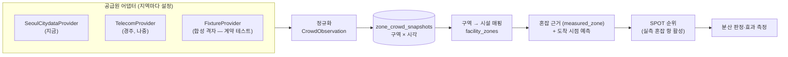

# 서울 테스트베드 — 실시간 유동인구 기반 시스템 사전 구축·검증 계획

> 상태: **진행 중(2026-11-01) — S0~S6 구현 완료(`yunseong`, main 미반영). S4 재생 평가는 홍대 반출(사람 작업) 대기 — 받는 대로 1차(예비) 결과를 낸다. 종로는 수집 14일 이상 뒤 같은 명령으로 재실행(약 28일 전에는 표본 부족일 가능성이 크다)**. 진행표는 §6 끝, 실행 절차는 §6 'S4 — 분산 결정 재생 실행'. 같은 날 앞선 판('현재 이해' 정리)은 git 이력에 있다(`e5703d6`).
> 앞선 계획은 [`CONGESTION_ENGINE_PLAN.md`](./CONGESTION_ENGINE_PLAN.md)(D1~D6 결정 완료·구현됨)이고, 전체 방향은 [`PRODUCT_EVALUATION_PLAN.md`](./PRODUCT_EVALUATION_PLAN.md) §0 이다.
> 표기: **[확인]** 코드·문서·git 에서 직접 본 것 · **[추정]** 근거로 미루어 판단한 것 · **[제안]** 이 문서가 새로 내놓는 설계(승인 전).

## 0. 요구사항(사용자, 2026-10-31)

1. **서비스 지역은 경주다.** 앱의 목표 지역은 바뀌지 않는다.
2. **경주의 실시간 유동인구 데이터는 지금 얻기 어렵다.** 통신사 데이터는 사업자금을 들여 나중에 확보한다.
3. **서울은 이미 공공 API(서울 실시간 도시데이터)를 준다.** 서울로 시스템을 **미리 구축하고 검증**한다.
4. **경주 통신사 데이터가 들어오면 앱이 바로 작동해야 한다.**
5. 공모전이 끝나 공공기관 API 의존 의무는 사라졌다. 데이터는 목적에 맞게 고르되 라이선스는 지킨다.
   **→ 2026-11-12 정정: 관광공모전 전면 재심사가 정해져 TourAPI 활용 필수가 다시 살아났다.** 재심사 동안 서울 S3(지역 격리)는 main 에 올리지 않고, 리허설(엔진 검증) 화면의 developer 전용(`50ed9b8`)은 되돌릴 대상이다 — [`contest/REJUDGE_REVERT.md`](./contest/REJUDGE_REVERT.md) A4·B9.

**이 계획의 성공 기준**[제안] — §4 합격 기준이 숫자를 정한다.
- **G1 엔드투엔드**: 서울 데이터로 수집 → 정규화 → 구역 혼잡 → 도착 시점 예측 → 추천 순위 → 분산 판정이 끝까지 돈다.
- **G2 결정 품질**: 실측이 있을 때 추천이 기준선(머물기·가장 가까운 곳·무작위)보다 도착 시점에 덜 붐비는 곳을 고른다는 것을 신뢰구간과 함께 보인다.
- **G3 전환 준비**: 경주 통신사 데이터는 **어댑터 1개 + 구역 정의 + 설정**만으로 켜진다. 추천 엔진·화면 코드는 바꾸지 않는다.
- **G4 데이터 계약**: 통신사에 요구할 명세(해상도·지연·필드·라이선스·이력)가 문서로 있다. 사업자금을 넣는 순간 바로 견적·협상에 쓸 수 있다.

## 1. 이전 판과 무엇이 달라지나

| | 이전(09-20 계획 · 10-31 앞선 판) | 이번 판 |
|---|---|---|
| 서울의 역할 | 경주용 **추정기**(주차 → 인파)를 검증하는 곳 | 실측 유동인구가 있을 때의 **본 시스템**을 미리 만들고 검증하는 리허설 지역 |
| 핵심 산출물 | 추정 정확도 지표 7개 · 보정 곡선 | 데이터 공급원 추상화 · 구역 모델 · 실측 기반 순위 · 분산 결정 재생 평가 · 통신사 데이터 계약 명세 |
| 경주와의 관계 | 서울에서 보정한 곡선을 경주 추정에 옮긴다 | 경주는 통신사 데이터가 들어오면 같은 시스템에 **공급원만 바꿔 끼운다**. 추정 모드는 그 전까지의 폴백 |
| 관광객 앱 서울 모드 | 하지 않는다(D3-B) | 공개는 하지 않는다. **내부(관리자·개발자) 검증용 서울 지역 팩**은 둔다(§7 Q1) |

추정기 검증(지표 7개·보정)은 버리지 않는다. 경주 출시 초기, 통신사 데이터 전의 폴백 품질을 설명하는 근거로 남긴다.

## 2. 지금 있는 것 (코드 기준 [확인])

| 기능 | 위치 | 상태 |
|---|---|---|
| 서울 수집기(조회·파싱·대상지명 대조·주차 필터·추정·저장) | `apps/api/app/services/seoul_citydata_service.py` | 구현, 테스트 30 |
| 수집·상태 API | `routers/engine_validation.py` — `POST /api/v1/engine-validation/seoul/collect`(기계·개발자), `GET …/seoul/status`(개발자) | 구현 |
| 저장 | `seoul_citydata_snapshots`(대상지·10분 버킷 유니크, service_role 만) — `20260920120000` | 운영 적재 중 — 09-20 23:40 KST 부터 5곳 10분(S0 A) |
| 스케줄 | pg_cron 10분 + 보충(`20260920121000`), 보충 예산(`20260920140000`) | **둘 다 적용됨**(S0 C — 보충 `9,39 * * * *`). 수집 호스트는 Render 싱가포르 API(S0 D) |
| 혼잡 공급원 층(S1) | `services/crowd/` — `CrowdObservation`·`CrowdProvider`·`seoul_provider`·`store`·`telecom_template` | 구현(`b6cb50a`·`20096dd`). 수집기가 저장한 대상지를 `zone_crowd_snapshots` 에도 저장(이중 저장) |
| 구역 표(S1) | `zones`·`zone_crowd_snapshots`·`facility_zones` — `20261031120000`(RLS, service_role 전용) | 원격 적용 대기(사람 작업). 없으면 수집은 그대로, 이중 저장만 상태에 남긴다 |
| 추정 정확도 지표·판정 | `services/engine_validation_metrics.py` | 구현 |
| 보정(주차 → 인파 곡선, 관문 통과 시 경주 추정에 자동 적용) | `services/congestion_calibration_service.py`, `congestion_estimator_service.py:178-187` | 구현 |
| 대안 패널(홍대 → 연남동·합정, SPOT 미사용) | `services/seoul_alternatives_service.py` | 구현(시연용) |
| 관리자 화면 | `apps/web/app/admin/engine-validation/page.tsx` | '실시간 데이터 리허설'(S6, 옛 '엔진 검증'). **11-01 부터 developer 전용**(API 403 · 메뉴·대시보드 링크는 개발자에게만) |
| 분산 결정 재생(S4) | `apps/api/scripts/crowd_dispersion_replay.py`(`sql`·`run`) + `services/batch/crowd_replay_data.py`·`crowd_replay_engine.py`·`crowd_dispersion_replay.py` · `services/kst_calendar.py` | 구현(11-01) — 오프라인(CSV 입력, DB·네트워크 없음). 요약은 `services/crowd/data/decision_quality/<cluster>.json` 을 커밋하면 화면에 실린다 |

- 쓰는 필드는 다음과 같다.
  - `LIVE_PPLTN_STTS`: `AREA_CONGEST_LVL`(4단계 정답), `AREA_PPLTN_MIN/MAX`, `PPLTN_TIME`, `FCST_PPLTN`(서울시 예측)
  - `PRK_STTS`: 주차장
- 호출은 대상지 1곳에 1회씩이고, 일 1,000회 한도다. 이력 API 는 없다. 공공누리 제1유형이다. [확인]
- **운영 수집은 돈다(S0, 사용자가 SQL A~E 실행 — 결과는 §7 표).** [확인]
- **S0 결과 해석(Claude, A~D)** — E 는 §7 'A8 해석'에 있다.
  - A: 5곳 모두 09-20 23:40 KST ~ 10-31 16:30 KST, 곳마다 5,825~5,829행이다. 차례였던 버킷 5,862개 대비 **약 99.4%** 다.
  - B: 거의 모든 날이 144/일이다. 크게 빈 날은 09-26(122)·09-27(136)뿐이고 5곳이 같은 수만큼 비었다 — 대상지 문제가 아니라 수집 쪽(호출·호스트)이 멈춘 시간으로 본다 [추정]. 최근 2주는 §4 V1(채움률 ≥ 98%)을 넘는다.
  - C: 보충 예약이 `9,39 * * * *` 다 → `20260920140000` 적용됨. 이 가정 위에서 S2 호출 예산(최악 864회/일)을 셌다.
  - D: 수집 URL 호스트가 싱가포르 `nextspot-t2ib.onrender.com`(10-09 교체)이다. 수집은 Render API 를 거친다 — API 가 멈추면 서울 수집도 멈춘다.
  - 뜻: 홍대 권역 3곳(주차 0 — 실측만)과 명동·동대문은 **40일치 실측**이 이미 있다(S4 재생 평가 재료). 종로 4곳은 S2 배포 뒤부터 쌓인다(2~4주).

## 3. 목표 아키텍처 [제안]

공급원(서울 공공 API · 경주 통신사)이 무엇이든, 추천 엔진은 **정규화된 '구역 혼잡 관측'** 하나만 본다.



**3.1 공급원 인터페이스**
- `fetch_current(zones) -> list[CrowdObservation]`
- `fetch_forecast(zones, horizon) -> list[CrowdForecast]` (선택)
- `describe() -> 주기·지연·해상도·라이선스`
- 실패는 예외가 아니라 '관측 없음'으로 돌려준다.
- 지금 수집기의 조회·파싱 로직은 `SeoulCitydataProvider` 로 옮기고, 수집 경로·표는 유지한다.

**3.2 정규화 스키마 `CrowdObservation`**

| 필드 | 뜻 | 서울 | 경주 통신사(예상) |
|---|---|---|---|
| `zone_id` | 구역 | 주요 장소 코드(POI007 등) | 격자 셀 ID · 집계구 |
| `observed_at` · `period` | 관측 시각 · 집계 단위 | `PPLTN_TIME` · 약 5~10분 | 계약에 따라(목표 ≤10분) |
| `population` (min/max/point) | 인원 추정 | `AREA_PPLTN_MIN/MAX` | 셀 인원 추정 |
| `level` · `level_scale` | 0~1 정규화 + 원래 단계 | `AREA_CONGEST_LVL` 4단계 | 기준선 대비로 산출(§3.5) |
| `forecast[]` | 대상 시각별 예측 | `FCST_PPLTN` | 제공되면 사용, 아니면 자체 예측 |
| `source` · `quality` | 공급원 · 표본/결측/지연 플래그 | | |

**3.3 구역(zone) 모델**
- 테이블은 `zones(zone_id, region, kind, name, geometry, centroid)` 이다. `kind` 는 `hotspot_polygon` | `grid_cell` | `admin_area` 중 하나다.
- 서울 주요 장소의 영역 경계는 서울시가 공간 데이터로 따로 공개한다(주요 121장소 영역 파일 — S1 의 9곳 시드는 그 다각형의 넓이 중심이다). 경주는 통신사 격자를 그대로 쓴다.
- **해상도가 핵심이다.**
  - 서울 주요 장소는 '권역' 단위라, 같은 권역 안의 가게들은 같은 값을 받는다. 그래서 서울로는 **권역 간 분산**(홍대 → 연남동)을 검증한다.
  - 황리단길 안의 골목을 구별하려면 경주 데이터는 **100~250m 격자 이하**여야 한다. 이 요구는 §5 계약 명세에 넣는다.

**3.4 시설 → 구역 매핑 `facility_zones(facility_id, zone_id, method, weight)`**
- 점-다각형 포함, 또는 가장 가까운 격자로 매핑한다.
- 밤 배치로 미리 계산한다. 시설·구역이 바뀌면 다시 돈다.

**3.5 구역 혼잡을 추천에 넣기**
- 새 근거 등급은 `measured_zone`(공급원 실측)이다.
  - 신선도 30분 안이면 `measured_rules` 경로로 순위에 들어간다.
  - 지금 경주의 '추정'(혼잡 항 영향 ≤ 약 0.05)과 달리, **혼잡이 후보를 실제로 구별**하게 된다.
- 통신사 인원 → 0~1 단계 환산은 **구역별 기준선**(같은 요일·시간대 분포의 분위수)으로 한다. 기준선이 쌓이기 전에는 공급원 단계 또는 보수적 절대 임계값을 쓰고, 그 사실을 표시한다.
- 도착 시점 예측은 이 순서로 고른다.
  1. 공급원 예측(`FCST_PPLTN` 등)
  2. 자체 모델(이력이 쌓인 뒤 학습)
  3. 지속성(현재값 유지, 30분 이내만)
- 순서마다 라벨을 붙인다.
- 재배치기여 항(`score.py` relief)이 실측 근거에서도 켜지도록 확인한다. 지금은 모델 예측이 있을 때만 켜진다(`score.py:228-236`).

**3.6 지역 팩**
- 웹 `apps/web/lib/region.ts`(중심·경계·프리셋)와 API 지역 설정(공급원·구역 출처·POI 출처)을 한 묶음으로 둔다.
- **서울 팩은 내부 검증용이다.** 관리자·개발자에게만 열고 관광객에게는 노출하지 않는다.
- 서울 POI 는 TourAPI 서울 지역 적재로 채운다. 카카오 로컬 영속 적재는 약관 위험으로 이미 접은 길이다(`archive/KAKAO_LOCAL_EXPANSION.md`).

## 4. 검증 계획 — 서울이 증명할 것 [제안]

| # | 무엇을 | 방법 | 합격 기준(제안 — §7 Q3 에서 확정) |
|---|---|---|---|
| V1 | 파이프라인 신뢰성 | 수집 성공률·결측 버킷·관측→반영 지연을 대상지별로 매일 집계 | 7일 연속 버킷 채움률 ≥ 98%, 지연 중앙값 ≤ 15분 |
| V2 | 실측이 순위를 움직이는가 | 같은 후보 집합에서 실측 혼잡을 넣고 뺀 순위 비교(민감도) | 실측이 있을 때 1위가 바뀌는 비율과 점수 영향 분포를 보고(경주 추정 ≤0.05 와 대비) |
| V3 | **분산 결정 품질(핵심)** | **분산 결정 재생**(아래) | 붐비는 출발지 중 대안 2곳 이상인 결정에서 추천지가 도착 시 ≥1단계 덜 붐빌 확률이 '가장 가까운 곳' 기준선보다 ≥ 10%p 높고, 그 차의 판정 하한(일 블록 부트스트랩 95% 하한과 날짜 군집 t 95% 하한 중 작은 쪽) > 0 |
| V4 | 도착 시점 예측 | 공급원 예측 · 자체 모델 · 지속성의 10~60분 오차 비교 | 30분 예측 MAE 가 지속성보다 낮음(아니면 지속성 사용) |
| V5 | 장애 대응 | 공급원 정지·지연·이상값을 주입해 폴백과 화면 라벨 확인 | 근거 없는 '정상' 표시 0건, 폴백 전환 ≤ 1 수집 주기 |
| V6 | 추정 모드 폴백 품질 | 기존 추정 정확도 지표(명동·동대문) | 기존 판정 기준 유지 — 경주 출시 초기 폴백의 근거 |

**분산 결정 재생(V3)**
1. 수집된 서울 실측을 시각 순서대로 다시 흘린다.
2. 각 10분 버킷 t, 출발 권역 o 마다 실제 추천 경로(SPOT — 취향 중립·쿠폰 0·이동시간은 권역 간 실제 보행/대중교통 추정)로 대안 r 을 고른다.
3. 도착 시점 t+이동시간의 **실측**으로 채점한다.
4. 기준선(머물기 · 가장 가까운 권역 · 무작위 · 오라클)과 비교한다.

- 지표: 기회율(출발지가 붐비고 덜 붐비는 이웃이 있는 비율), 적중률, 단계 차, 오라클 대비 손실, 피한 대기(모델 — 라벨 명시).
- 신뢰구간: 10분 버킷끼리 강하게 상관돼 있으므로 일 단위 블록 부트스트랩으로 낸다.
- 한계(문서에 고정)
  - 서울에는 우리 사용자가 없어 **행동 변화·혼잡 감소는 재지 못한다.** '한 사람이 옮겨도 혼잡은 변하지 않는다'는 가정 아래의 결정 품질이다.
  - 혼잡 감소는 경주 파일럿에서 잰다. 방법은 `PRODUCT_EVALUATION_PLAN.md` P3-1 의 스위치백 또는 이중차분이다.
- 구현(S4, 11-01)에서 정한 것: 이동시간은 **도보만**(권역 안 쌍은 모두 2.4km 이하라 대중교통은 쓰지 않는다)이고 두 벌이다 — 엔진 입력과 대안 자격은 라우터가 서울에서 실제로 쓰는 추정(직선 × 1.18 ÷ 66.67 m/분, 0.1분), 정답 도착 시각은 보수적 추정(직선 × 1.4 ÷ 66.67 m/분, 올림). 대안은 라우터 이동으로 도보 상한 20분 안 구역뿐(운영 경로가 낼 수 없는 곳은 어느 정책도 고르지 않는다), V3 모집단은 출발지가 '약간 붐빔 이상'이고 대안이 2곳 이상인 결정(대안 1곳이면 엔진 = 가장 가까운 곳이라 뺀다), 'CI 하한 > 0' 은 **(엔진 − 가장 가까운 곳) 차의** 판정 하한(부트스트랩·날짜 군집 t 중 작은 쪽)이다. 결정 규칙·최소 표본·실행 절차는 §6 'S4 — 분산 결정 재생 실행'.

## 5. 경주 전환 준비 — 통신사 데이터 계약 명세(초안) [제안]

사업자금을 들여 데이터를 살 때, 아래 항목을 견적·계약 요청서로 바로 쓴다. 확정값은 비용과 함께 §7 Q6 에서 정한다.

| 항목 | 요구(초안) | 이유 |
|---|---|---|
| 공간 해상도 | **50m 격자 목표**, 최소 250m 이하(황리단길 반경 2km 전 격자) | 골목 단위로 후보를 구별해야 분산이 된다. 작은 칸은 칸마다 오차가 커서 구역으로 묶어 쓴다(§7 A6) |
| 시간 해상도 · 지연 | 10분 집계, 관측→수신 ≤ 15분 | 도착 시점(도보 5~20분) 판단 |
| 지표 | 체류 인구 추정치(내·외국인 구분이면 더 좋음), 신뢰 구간 또는 표본 플래그 | 단계 산출과 '모름' 표시 |
| 예측 | 있으면 1~3시간 예측 | 없으면 자체 모델(이력 필요) |
| 이력 | 계약 시작 전 최소 8주 백필 | 구역별 기준선·예측 모델 학습 |
| 제공 방식 | API(pull) 또는 주기 파일, 가용성 SLA | 수집기·경보 설계 |
| 라이선스 | 상업 서비스 화면 표시·파생 지표·B2G 리포트 사용 허용 | 앱·관제·보고서 모두 쓴다 |
| 개인정보 | 집계·가명 기준(최소 인원 마스킹) 명시 | 위치정보법·개인정보 검토(평가 문서 P3-5) |

- 후보(가격·조건 확인 필요)
  - 통신 3사의 유동인구 데이터 상품(예: SKT '지오비전 퍼즐' 등)
  - 경상북도·경주시 빅데이터 협력
  - 한국관광공사 데이터랩(집중률 — 이미 사용 중, 상대지수라 단독으로는 부족)
- **공급사에 보낼 요구 명세는 [`CROWD_DATA_CONTRACT.md`](./CROWD_DATA_CONTRACT.md)** 다(S5 — 위 표를 견적·계약 요청서 꼴로 풀고, 공급사에 물을 질문과 `CrowdObservation` 필드 대응표를 더했다). 가격·실제 주기·SLA 는 지어내지 않고 '견적에서 확인'으로 둔다.
- **전환 키트**(S5, `20096dd` 완료): 합성 격자 픽스처, 어댑터 템플릿(`services/crowd/telecom_template.py` — 수집·엔드포인트에 아직 연결하지 않음)과 공급원 계약 테스트, 전환 체크리스트로 구성한다.
- 남은 결정(체크리스트 6단계·S3): 인원 → 단계 분위수를 '평소 대비'(같은 구역·요일·시간대 기준선)로 둘지 '절대 붐빔'으로 둘지, 기준선이 쌓이기 전 잠정 임계값.
  - 공급원 샘플 데이터를 받는 즉시 어댑터를 검증할 수 있게 만든다.
  - 체크리스트: 구역 적재 → 시설 매핑 → 어댑터 → 설정 전환 → 기준선 2주 축적 → 단계 임계값 확정 → 모니터링.

## 6. 구현 단계 [제안]

| 단계            | 범위                                                                                                                 | 증명·산출                | 규모             |
| ------------- | ------------------------------------------------------------------------------------------------------------------ | -------------------- | -------------- |
| S0 확인(사람)     | 운영 서울 수집 점검 SQL A~E 실행, Render `SEOUL_OPENDATA_KEY`·Vault 수집 URL 호스트 확인, `20260920140000` 적용                       | 데이터가 어느 대상지에 며칠치 있는지 | 0.5일           |
| S1 데이터 계층 일반화 | 공급원 인터페이스 + `CrowdObservation` + 서울 어댑터 이전, `zones`·`zone_crowd_snapshots`·`facility_zones` 마이그레이션(원격 적용은 사람), 테스트 | G3 의 뼈대              | 2~3일           |
| S1 질문         | 규모가 2~3일로 적혀있는데 작업량이 그렇게 많아? 몇 시간 정도 자율진행 맡겨놓으면 완료되는거 아냐? 그리고 G1, G2, G3, G4는 무슨 의미야?                              |                      |                |
| S1 답(Claude) | 맞다 — 표의 일수는 사람 개발자 기준이었다. 에이전트가 맡으면 S1 코드·테스트는 **3~5시간**(검토 1회 포함)이다. 다만 어젯밤 영업시간 해석처럼 독립 검증에서 고칠 것이 나오면 한두 번 더 돈다(그때는 코드 1~2시간, 검증·수정 6회로 반나절 넘게 걸렸다). 줄지 않는 것은 사람·외부 몫이다: 마이그레이션 원격 적용(SQL Editor), 수집 기간(S2 2~4주), 한도 상향 승인. 그래서 실제 일정을 정하는 것은 **S2 수집**이다 — 대상지를 먼저 정해 수집을 시작하고, S1·S3 는 그동안 만든다(표 아래 '에이전트 기준 규모').<br>**G1~G4 는 이 계획의 목표 네 개다(§1).** G1 엔드투엔드 = 서울 실데이터가 수집부터 추천·분산 판정까지 끝까지 흐른다. G2 결정 품질 = 그 추천이 '그냥 있기·가장 가까운 곳·무작위'보다 도착했을 때 덜 붐비는 곳을 고른다는 것을 숫자(신뢰구간)로 보인다. G3 전환 준비 = 경주 통신사 데이터는 어댑터 1개 + 구역 정의 + 설정만 바꾸면 켜진다. G4 데이터 계약 = 통신사에 낼 요구 명세(§5)가 문서로 준비돼 있다. | | |
| S2 서울 대상지 재설계 | 경주와 닮은 종로 유산 권역 + 홍대 권역, 호출 한도 계획(아래)                                                                              | 권역 간 대안이 성립하는 표본     | 0.5일 + 수집 2~4주 |
| S3 엔진 연결      | `measured_zone` 근거, 도착 시점 예측 순서, 재배치 기여 항 확인, 서울 지역 팩(내부 전용)                                                       | G1 엔드투엔드             | 3~4일           |
| S4 재생 평가      | 순수 함수 + `apps/api/scripts/crowd_dispersion_replay.py` + 테스트 + 보고(V2~V4)                                            | G2 결정 품질             | 2~3일           |
| S5 경주 전환 키트   | 계약 명세 문서 확정, 합성 격자 픽스처, 어댑터 템플릿·계약 테스트, 체크리스트                                                                      | G3·G4                | 1~2일           |
| S6 관리자 화면     | '엔진 검증'을 '실시간 데이터 리허설'로 재구성. 수집 상태를 사실대로(`not_migrated`·`empty` 를 '가동 중'으로 보이지 않게), 결정 품질·예측 오차                    | 운영자가 상태를 안다          | 1~2일           |

**에이전트 기준 규모(2026-10-31 답)** — S1 3~5시간 · S2 설정 1시간 + 수집 2~4주(줄일 수 없음) · S3 1~2일(A1 로 서울을 내부 전용 서비스 지역으로 넓혀서 커짐) · S4 3~5시간 · S5 2~3시간 · S6 3~5시간. 각 단계 뒤 검토 에이전트 1~2회와 CI 를 포함한 값이다. 사람 작업(마이그레이션 원격 적용·한도 신청)은 따로다.

**진행(2026-11-01, `yunseong` — main 미반영)**

| 단계 | 상태 | 커밋 · 남은 것 |
|---|---|---|
| S0 | ✅ 완료(사용자) | SQL A~E 결과는 §7 표, 해석은 §2. `20260920121000`·`140000` 적용 확인 |
| S1 | ✅ 구현 | `b6cb50a` · 수집 마감 `4052f68`. 남은 것: `20261031120000` 원격 적용(사람) |
| S2 | ✅ 설정 | `b6cb50a` → 주기 재설계 `c534783`(아래). 남은 것: Render `SEOUL_CITYDATA_TARGETS` 정리 · 종로 4곳 이름 확인 · API 배포 뒤 수집 2~4주 |
| S3 | ✅ 구현 | `cc6b299`·`40d6034`·`b563db2`·`50ed9b8`·`d22aeef`(아래 'S3'). 남은 것: HANDOVER 사람 작업 11-01 ①~⑥ |
| S4 | ✅ 구현 · 홍대 반출 대기 | `eec81e5`(KST 달력 · 지표 보완) · `66d6ab9`(재생) · `54f0c43`(화면) + 문서. 남은 것: 홍대 CSV 반출(사람) → `run --label pilot`(홍대 1차 · 예비) → 검토 뒤 기준 해시 고정 → 종로 14일+(현실적으로 28일) 뒤 `--label confirmatory` 재실행(아래 'S4') |
| S5 | ✅ 구현 | `20096dd` · 어댑터 틀 보정 `22ecc1d`. 남은 결정은 §5 |
| S6 | ✅ 구현 | `65a45ff` · `8c0de61`. 결정 품질 카드는 S4 요약(`crowd/data/decision_quality/<cluster>.json`)이 커밋될 때까지 '아직 없음'(`not_evaluated`) |

**S3 — 서울을 개발자 전용 내부 지역으로(11-01, 사용자 결정 반영)**
- **누가 보나**: `users.role = 'developer'` 만. 서버가 매 요청 `X-NextSpot-Region` 헤더(요청일 뿐)를 역할로 다시 판정한다(`app/core/region.py`) — admin·심사 계정·사장님·관광객·게스트는 경주로 내려가고 `/internal/regions` 는 403. 웹은 개발자에게만 지역 스위처(/main·/mypage)와 배지를 보이고, 서울 이름·좌표는 번들에 없이 서버 응답으로 팩을 만든다.
- **DB 가 막는다**(`20261101090000`): `facilities.region` · 브라우저(anon·authenticated — 개발자 브라우저도)는 RESTRICTIVE 정책으로 경주 행만 · 추천·피드백 행의 서울 표식도 같은 방식 · 자식 표 6곳은 서울 시설 id 쓰기를 트리거로 거절 · 지역 변경 금지 · 체감 혼잡 투영은 경주만. 서울 화면은 역할 검사를 거친 API 로만 채운다. `region_isolation_status()` 가 이 전부를 카탈로그로 확인하고 `/health` 는 `capabilities.region_isolation=1` 을 낸다.
- **region-guard**(30분, `.github/workflows/region-guard.yml`): 격리가 깨졌거나 anon 이 서울 행을 보면 `region_guard_contain()` 으로 정책을 되살리고 서울 행을 끈다(자동 비활성화 — 사용자 결정). `/health` 를 못 읽으면 경보만.
- **엔진**: 구역 실측은 `measured_rules` 근거(tier 0)다. 도착 시각 단계는 '지속(관측 30분 안)'과 '공급자 예보(발행 90분 안, 목표 ±30분)' 중 시간이 가까운 쪽, 동률이면 지속. 다구역 시설은 도착 시 최댓값이고 매핑 구역이 하나라도 비거나 오래되면 단계를 주장하지 않는다. 재배치 기여는 '출발지에 그대로 있었을 때의 도착 시각 단계'와 비교한다(같은 구역 = 0). 도착 시 'busy' 는 기존 0.9 경계로 내리고 'slightly_busy' 는 내리지 않는다. 서울에는 경주 전용 사전확률(지역 수요·집중률·Tmap)·경주 모델·주차 추정·업종 기준선·`congestion_logs` 를 쓰지 않는다.
- **'평소 대비'는 문구만**(`20261101091000` `zone_population_baseline` — 같은 KST 시·평일/주말, 28일, 중복·대체값 제외, 표본 4 이상). 순위는 절대 단계(결정). 기준선 조회는 순위 경로 밖에서 백그라운드로 채운다.
- **표시**: 구역 단계는 앱 공통 혼잡 등급(한산·여유·보통·혼잡)으로 쓰고 서울시 원문 4단계는 화면에 쓰지 않는다. 근거 줄은 '{구역} 일대 실시간 인구 기준 · N분 전 관측' 또는 '{시각} 도착 기준 예측'.
- **서울에서 꺼지는 것**(결정 2): 혼잡·영업 제보, 체감 혼잡 질문·저장, 자리 알림·타임세일, 쿠폰 발급, 공유, 날씨·축제·주차·발견·외부 검색·예보 띠.
- **장소**: `ingest-seoul.yml`(수동, 기본 dry_run) → `ingest_tourapi_seoul.py` → `map_facility_zones.py`. 쓰기 전후로 시험용 관광객 계정으로 서울 행이 안 보이는지 확인하고, 새면 이번 실행 행을 끄고 지운다.
- **함께 바뀐 것**: '실시간 데이터 리허설'(엔진 검증) 화면·API 도 서울 실측을 보여 developer 전용이 됐다(pg_cron 기계 토큰 수집은 그대로).

**S4 — 분산 결정 재생 실행(11-01 구현 · 홍대 반출 대기)**

§4 V3(분산 결정 품질)·V2(실측이 순위를 움직이나)·V4(도착 시점 예측 오차)를 **오프라인**으로 잰다. 운영 DB 에는 닿지 않는다 — 사람이 SQL Editor 에서 읽기 전용 SELECT 로 CSV 를 받고, 재생은 그 CSV 만 읽는다(DB·네트워크 없음).
- 코드: `apps/api/scripts/crowd_dispersion_replay.py`(`sql` · `run`) → `services/batch/crowd_replay_data.py`(CSV 검증·시간선) · `crowd_replay_engine.py`(실제 엔진 어댑터) · `crowd_dispersion_replay.py`(결정·지표·부트스트랩·판정·보고). 공용 달력은 `services/kst_calendar.py`(KST 공휴일 = 주말 취급, 서비스 날짜 05시 경계, 시간대 평균).
- 운영 API 는 재생 코드를 싣지 않는다(`batch/` 는 스크립트 전용 — `tests/structure/test_crowd_replay_isolation.py`). 화면은 커밋된 요약 파일만 읽는다(아래 ⑤).
- CSV 는 운영 수집기가 쓰는 검증·정규화 사슬을 그대로 탄다(`parse_citydata` → `observation_from_parsed` → `store.snapshot_row` → `reading_from_snapshot`). 틀린 행은 추측하지 않고 파일·줄·칸·코드를 모두 모아 종료 코드 2로 멈춘다.

*실행 순서 — 홍대 1차(예비) 결과*

① **SQL 받기.** 아래 블록을 그대로 쓰거나 다시 인쇄한다(날짜는 KST, `--to` 는 배타이고 기본은 오늘 KST 자정 — 아직 쓰이고 있는 오늘은 거부한다).

```powershell
cd D:\NextSpot\apps\api
.\.venv\Scripts\python scripts/crowd_dispersion_replay.py sql --cluster hongdae --from 2026-09-20 --to 2026-11-01
# 결과가 편집기 한도에 잘리면: ... --chunk-days 10   (한 대상지만: --site 연남동)
```

```bash
cd apps/api && .venv/Scripts/python scripts/crowd_dispersion_replay.py sql --cluster hongdae --from 2026-09-20 --to 2026-11-01
```

② **Supabase SQL Editor 에서 실행.**
- 결과 한도 선택을 **'No limit'**(없으면 가장 큰 값)으로 둔다.
- 문장을 **하나씩** 붙여 실행한다. 여러 문장을 한 번에 돌리면 결과 창에는 마지막 것만 남는다.
- 순서: Q0(대상지마다 1행 — 3행) → 대상지별 Q1·Q2(6개) → 선택 Q3-count(구역마다 1행) → 구역별 Q3(3개).
- 내려받기 전에 결과 바닥의 행 수를 목록과 대조한다 — Q1 = 그 대상지의 `n_obs_total`, Q2 = `n_fcst_kept`(Q0), Q3 = 그 구역의 `n_rows`(Q3-count). 다르면 잘린 것이니 `--chunk-days 10` 으로 다시 인쇄해 조각마다 받는다(Q1·Q2·Q3 이 같은 조각으로 나뉘고, 로더가 조각을 합쳐 목록과 구역·날짜별로 다시 대조한다).
- 내려받은 파일 이름을 각 블록 머리 주석(`-- ===== Q1 → obs_…csv`)대로 바꾼다. 로더는 `counts.csv` · `obs_*.csv` · `fcst_*.csv` · `counts_replaced.csv` · `replaced*.csv` 이름으로 찾는다.
- Q3-count·Q3 은 `20261031120000`(구역 표)이 운영에 있어야 돈다. 'relation … does not exist' 면 **둘 다** 건너뛴다(대체값 표시가 없다는 사실이 보고서 한계에 남는다). Q3 조각을 받았으면 Q3-count 도 반드시 둔다 — 없거나 행 수가 다르면 로더가 종료 2로 멈춘다(잘린 Q3 의 뒤 행이 '표시 없음' 으로 읽혀 대체값이 실측처럼 쓰이는 것을 막는다).
- 홍대 크기 추정: Q1 대상지당 약 5,900행(≈0.9MB) · Q2 대상지당 약 2만~2.4만 행(≈2.5MB).

③ **저장.** 내려받은 그대로(UTF-8) 한 폴더에 둔다. **엑셀로 열어 저장하지 않는다**(한글·시각 형식이 바뀐다 — BOM 은 있어도 된다).
- 권장: 저장소 밖 `$HOME\nextspot-s4\hongdae`(bash `~/nextspot-s4/hongdae`).
- 저장소 안에 둘 때는 `apps/api/.replay-data/hongdae/` 만 허용한다(`.gitignore`·`apps/api/.dockerignore` 에 있음). 그 밖의 저장소 경로·`apps/api/app/` 아래 출력은 경로 가드가 거부한다(종료 3).

④ **재생**(메인 세션). 홍대 40일 · 민감도 포함 약 20~30초.

```powershell
cd D:\NextSpot\apps\api
.\.venv\Scripts\python scripts/crowd_dispersion_replay.py run --cluster hongdae --data-dir $HOME\nextspot-s4\hongdae --label pilot
```

```bash
cd apps/api && .venv/Scripts/python scripts/crowd_dispersion_replay.py run --cluster hongdae --data-dir ~/nextspot-s4/hongdae --label pilot
```

- 산출(기본 `<data-dir>/out/`): `hongdae_replay_report.json`(전체 집계 · 스키마 `crowd_dispersion_replay/2`) · `hongdae_replay_summary.md`(50줄 이하) · `decision_quality/hongdae.json`(화면용 요약 `decision_quality_summary/3`, 16KB 이하 — 숫자는 V3 모집단(`population=crowded_origin_choice_feasible`) 것이고 notes 첫 줄이 대안 1곳이라 뺀 결정 수·비율을 말한다. V3 에 판정 하한 `gate_low`·`ci_low_t`, 미달이면 언제나 사유). `--trace` 를 주면 `hongdae_decisions_trace.csv`(결정 행)도 쓴다.
- 같은 입력이면 같은 바이트가 나온다(입력은 파일 이름 + SHA-256, 부트스트랩 시드 고정, 실행 시각 없음).
- 종료 코드: 0 성공 · 2 입력·설정 오류(문제 전부 출력 — 칸 수가 머리줄과 다른 행(`row_width_mismatch`: 잘린 내려받기·고친 행)도 여기다) · 3 경로 가드 · 4 기준 해시 불일치·확인 실행 규칙 위반.
- 빠른 확인만 할 때는 `--no-sensitivity`(이동 1.18 재실행 생략). 확인 실행(`confirmatory`)에는 쓸 수 없다(종료 4). `--detour` · `--truth-tolerance-min` · `--no-forecast` 는 판정 인자를 덮으므로 실행 성격이 자동으로 `exploratory` 가 된다.

⑤ **커밋하는 것과 하지 않는 것**(메인 세션, 사용자 검토 뒤).
- `out/decision_quality/hongdae.json` → `apps/api/app/services/crowd/data/decision_quality/hongdae.json`(이름·내용 그대로). '실시간 데이터 리허설' 화면의 결정 품질 카드가 이 파일을 읽는다. API 데이터라 main 반영은 KST 밤.
- 요약 마크다운(필요하면 보고서 JSON)은 `docs/archive/reports/<날짜>-s4-hongdae.md` 로 두고 `docs/README.md` 색인에 한 줄.
- **원본 CSV 와 결정 추적 CSV 는 커밋하지 않는다.**

*결정 규칙(엔진 재생)*
1. 권역의 구역이 차례로 출발지 o 가 되고 대안은 나머지 구역 중 **도보 상한 20분 안**인 곳이다(라우터 `max_walk_minutes` 의 최댓값 — 라우터는 경로 분이 상한보다 길면 후보에서 뺀다. 재생도 **라우터가 계산하는 이동**(`router_travel_matrix` = `estimate_walking_route`)에 같은 비교를 걸고, 모든 정책이 같은 대안 집합에서 고른다). 상한 안 대안이 없는 출발지는 결정하지 않고 `decisions.skipped.no_alternative_within_walk_cap` 으로 센다. 결정 시각 t 는 출발지 버킷 b 마다 셋이다: 출발지 행을 받은 시각(분 올림, phase 0) · b + 5 · b + 10분. 30분 주기 출발지는 받은 시각 · +10 · +20분이다(20분 주기는 받은 시각 · +10분). 주기 끝(+30 · +20)은 넣지 않는다 — 관측이 버킷보다 앞서면(실데이터: 버킷 = 받은 시각의 10분 내림, 관측 ≤ 받은 시각) 그때 출발지 관측은 언제나 30분을 넘어, 종로 후보의 약 1/4 이 `origin_not_current` 로 빠지고 남은 것만 데이터가 고른 부분집합이 되었다(S4 검토 4차). 그래도 다음 정규 행이 오기 전에 자기 행이 30분을 넘기면 `decisions.skipped.origin_aged_out_before_next_row` 로 따로 세고 결정 후보에서 뺀다 — `origin_not_current` 는 실제로 빈 구간만 뜻한다. 고정 시각에 출발지 행이 아직 없으면 받은 시각까지 기다리고, 같은 t 는 한 번만 결정한다. 늦게 온 행의 시각에 더 새 출발지 행이 이미 보이면 그 시각은 새 버킷 몫이다(`decisions.skipped.origin_row_superseded_by_newer_row`). 처음 구현은 b + 10분 한 번이었다 — 관측이 가장 낡은 때라 지속(persistence) 도착 근거가 한 번도 쓰이지 않았다(S4 검토 3차).
2. t 에 아는 것 = `fetched_at ≤ t` 인 행뿐이다. 구역마다 최근 2시간 안의 최신 판독을 운영과 같은 순서로 고른다(`zone_evidence.select_latest_reading`). 출발지 근거가 현재가 아니면 그 결정은 건너뛴다.
3. 엔진 선택은 운영 경로 그대로다: `build_candidate_evidence` → `calculate_spot_score` → `spot_ranking_sort_key`(취향 중립 · 쿠폰 0 · 지역 seoul · 이동은 아래 표의 '라우터' 열 · 도보 상한 20분). 라우터와 같은 답을 내는지 `tests/routers/test_crowd_replay_engine_parity.py` 가 확인한다 — 손 값 · 재생이 엔진에 주는 행렬 · 상한 밖 대안 하나(21분)의 세 벌, 그리고 **경로 함수를 패치하지 않은** 실제 라우터가 홍대 관광특구에서 합정역(17.4분)을 내고 그 대안 집합이 모든 서울 구역 쌍에서 재생의 대안 자격과 같은지.
4. 채점은 도착 시각 t+τ 의 **실측** 등급이다. 허용 오차 max(5, 주기/2)분(홍대 5 · 종로 15) 안의 가장 가까운 관측을 쓴다. t 에 보이던 마지막 관측보다 뒤이고 t 뒤에 받은 것만 쓰고, 보간·이월은 없다. 출발지와 모든 대안에 정답이 있어야 채점한다(모든 정책이 같은 분모).
5. 적중 = 고른 곳이 '그대로 머물렀을 때 같은 도착 시각의 출발지'보다 1단계 이상 덜 붐빔. V3 모집단은 결정 시각에 출발지가 '약간 붐빔 이상'이고 **대안이 2곳 이상**인 결정이다. 대안이 1곳이면 엔진 = 가장 가까운 곳 = 오라클이라 차가 구성상 0 이다. 그 결정은 판정에서 빼고 수·비율(`verdicts.V3.forced_agreement`)과 섞은 차(`pooled_crowded`, 참고)를 함께 낸다.
6. 기준선: 머물기 · 가장 가까운 곳(V3 비교 대상) · 무작위(기대값) · 오라클. 보고용으로 시간대 평균 선택(실시간 데이터의 값) · 현재 등급 탐욕(SPOT 경로의 값) · 재배치 기여가 있을 때만 옮김(`engine_gated`)을 함께 낸다.

*이동 시간*(도보만 · 구역 중심 간 직선 기준) — **두 벌**이고 섞지 않는다(S4 검토 2차).
- **엔진 쪽 = 라우터 값**: 대안 자격(도보 상한 비교), 엔진에 주는 이동 분·m(`travel_time_override` · 정렬 키의 거리). 서울 구역 중심은 경주 보행 그래프에서 250m 넘게 떨어져 있어 `/recommendations` 의 `get_walking_routes` 는 언제나 `estimate_walking_route`(직선 × 1.18 ÷ 66.67 m/분, 0.1분 반올림, 올림 없음)를 낸다. 재생은 그 함수를 그대로 부른다(`crowd_replay_engine.router_travel_matrix`).
- **채점 쪽 = 보수적 값**: 정답 도착 시각 t+τ, 가장 가까운 곳·오라클의 동점 처리, 추가 이동. 직선 × 우회 1.4 ÷ 66.67 m/분, 분 올림. 엔진이 생각하는 것보다 늦게 도착한다고 보고 채점하는 쪽이다(도착이 관측에서 멀어져 엔진에 불리하다). 1.18·올림으로 채점한 결과는 보고서 `sensitivity.detour_1_18` 에 있다(대안 자격은 그대로).
- 권역 안 쌍은 모두 2.4km 이하라 대중교통은 쓰지 않는다. 보고서 `travel_matrix` 에 두 값(`minutes` · `engine_minutes`)이 함께 있다.

| 권역 | 쌍 | 직선 m | 라우터 분(×1.18 · 엔진 입력 · 상한 비교) | 채점 분(×1.4 · 올림) | 채점 분(×1.18 · 올림, 민감도) |
|---|---|---|---|---|---|
| 홍대 | 홍대 관광특구 ↔ 연남동 | 861 | 15.2 | 19 | 16 |
| 홍대 | 홍대 관광특구 ↔ 합정역 | 981 | 17.4 | 21 | 18 |
| 홍대 | 합정역 ↔ 연남동 | 1,651 | **29.2 — 상한 밖** | 35 | 30 |
| 종로 | 경복궁 ↔ 북촌한옥마을 | 690 | 12.2 | 15 | 13 |
| 종로 | 창덕궁·종묘 ↔ 인사동 | 837 | 14.8 | 18 | 15 |
| 종로 | 북촌한옥마을 ↔ 창덕궁·종묘 | 913 | 16.2 | 20 | 17 |
| 종로 | 북촌한옥마을 ↔ 인사동 | 949 | 16.8 | 20 | 17 |
| 종로 | 경복궁 ↔ 인사동 | 1,058 | 18.7 | 23 | 19 |
| 종로 | 경복궁 ↔ 창덕궁·종묘 | 1,468 | **26.0 — 상한 밖** | 31 | 26 |

- 홍대(라우터 이동): 홍대 관광특구 → 연남동·합정역(2곳) · 연남동 → 홍대 관광특구(1곳) · 합정역 → 홍대 관광특구(1곳). 운영 라우터가 내는 집합과 같다. 엔진이 가장 가까운 곳과 갈릴 수 있는 출발지는 **홍대 관광특구 하나**다(연남동 15.2분 대 합정역 17.4분) — 연남동·합정역 출발은 대안이 하나라 엔진 = 가장 가까운 곳이다. 그래서 홍대는 `thin_cluster`(대안 2곳 이하)이고, **V3 는 홍대 관광특구 출발 결정만으로 판정한다**. 연남동·합정역 출발 결정은 `forced_agreement` 로 따로 센다(합성 반출에서 붐빈 결정의 약 2/3). 예전처럼 섞으면 차가 그 비율만큼 묽어져(합성: 16.7%p → 5.6%p) '구조상 달성 불가' 미달이 기계적으로 나왔다(S4 검토 3차). 최소 표본은 홍대 관광특구 하나에서 채워야 한다 — 에피소드 20은 그곳이 붐빈 덩어리 수라 40일이면 넘지만 14일 남짓이면 모자랄 수 있다(합성 14일: `insufficient: episodes<20`). 결과는 **예비·참고**다(Q-S4-5).
  - 정정(11-01 S4 검토 2차): 처음 구현은 대안 자격에도 채점 이동(1.4 · 올림)을 썼다. 그러면 홍대 관광특구 → 합정역이 21분이 되어 빠지고, 합정역 출발 결정은 전부 '상한 안 대안 없음' 으로 빠져, 홍대 V3 가 불일치 0건으로 `insufficient` 가 '예상 결과' 였다. 운영 라우터는 그 쌍을 17.4분으로 계산해 합정역을 낸다 — 재생 자체의 이동 가정이 만든 결과였으므로 고쳤다. 기준 해시가 바뀌었다(아래).
- 종로(라우터 이동): 경복궁 → 북촌·인사동(2곳) · 북촌 → 경복궁·인사동·창덕궁·종묘(3곳) · 인사동 → 경복궁·북촌·창덕궁·종묘(3곳) · 창덕궁·종묘 → 북촌·인사동(2곳). 가장 많은 출발지가 3곳이라 `thin_cluster` 가 붙지 않는다. 대안 3곳인 북촌·인사동 출발은 Kendall τ 도 낸다(출발지별 `per_origin.eligible_alternatives`).

*판정 기준(`CRITERIA`)과 고정 규칙*
- 판정에 쓰는 값은 모두 `services/batch/crowd_dispersion_replay.py` 의 상수 `CRITERIA` 하나에 있다. `criteria_version` = `sha256(json.dumps(CRITERIA, sort_keys=True, ensure_ascii=False))` 의 앞 12자다.
- 요약: 붐빔 기준 등급 ≥ 2(약간 붐빔) · 정답 허용 max(5, 주기/2)분 · 채점 이동 1.4 / 66.67 m/분 / 올림 / 최대 60분 · 엔진 이동 = 라우터 `estimate_walking_route`(1.18 · 0.1분) · **도보 상한 20분(라우터 이동으로 대안 자격, 모든 정책 공통)** · V3 차 ≥ 0.10 과 차의 **판정 하한**(부트스트랩 하한과 날짜 군집 t 하한 중 작은 쪽) > 0 · V3 최소 n 100 · 붐빈 날 10 · 에피소드 20 · 불일치 30건/5일 · headroom 0.10(모두 V3 모집단 = 붐비는 출발지 중 대안 2곳 이상, n·불일치 최소는 서로 다른 (출발지, 버킷) 수로 센다) · 결정 시각 = 받은 시각 · +5 · +10분(30분 주기 받은 시각 · +10 · +20분, 다음 정규 행 전에 낡은 시각은 후보 아님) · 오라클 = 옮김을 강제한 가장 좋은 대안(머물기 손실은 max(0, 최대 이득)) · 보조 대비도 같은 판정 하한 · V4 리드 30분 칸 [15, 45)분 · 짝 100 · 10일 · 부트스트랩 2,000회 · 시드 20261101 · 95% 백분위(nearest-rank) · 블록 = 서비스 날짜(KST 05시 경계) · 블록 20 미만이면 '근사' · 빈 재표본 1% 초과면 표본 부족 · 시간대 평균 = (구역, KST 시, 평일/주말·공휴일), 앞선 날만, 칸당 4개 이상.
- **지금 해시: `bc852a570864`**(11-01 S4 검토 4차 — 주기 끝 결정 시각(30분 +30 · 20분 +20)을 빼고 다음 정규 행 전에 낡은 시각을 따로 셈. 3차: V3 모집단을 대안 2곳 이상 결정으로, 결정 시각을 수집 주기 안에 펼침(늦게 온 행은 새 버킷 몫), 최소 표본은 서로 다른 버킷으로, 오라클·보조 대비 규칙을 기준에 적음. 앞선 값 `00a548596838` · `6788f0d55780` · `0139e2f69f47` · `b4f225def959` 는 쓰지 않는다. 홍대 예비 실행용).
- **criteria_version: (Hongdae 검토 뒤 여기 고정)**
- 고정 규칙
  - 홍대 결과는 `pilot`(예비 — 기준 확정 전)이다.
  - 홍대 검토로 기준을 고친다면 **한 번만**, 종로 반출을 열어 보기 **전에** `CRITERIA` 를 고치고 새 해시를 바로 위 줄에 적는다.
  - 종로는 확인 실행이다: `--label confirmatory --expect-criteria <고정 해시>` 가 **반드시** 있어야 한다. 해시가 없거나 다르면 종료 4. 재생·엔진 소스(`apps/api/app` 전체와 스크립트 — 엔진 경로도 결과를 바꾼다)에 커밋하지 않은 변경이 있거나 git 으로 확인할 수 없어도(메시지에 git 의 오류를 붙인다), `--no-sensitivity` 를 주어도 종료 4다. 보고서 `run.source_version` 은 재생 모듈 넷(`crowd_dispersion_replay.py` · `crowd_replay_data.py` · `crowd_replay_engine.py` · `kst_calendar.py`)의 sha256 앞 12자이고, `code_version` 은 `apps/api` 에 커밋하지 않은 변경이 있으면 `-dirty` 가 붙는다.
  - 판정 인자를 덮는 옵션(`--detour` · `--truth-tolerance-min` · `--no-forecast`)은 실행을 `exploratory` 로 바꾸고, `confirmatory` 와 함께 쓰면 거부한다(종료 4).

*판정 읽는 법*
- **V3 통과** = V3 모집단(붐비는 출발지 · 대안 2곳 이상)에서 (엔진 적중률 − 가장 가까운 곳 적중률) ≥ 0.10 이고 **그 차의** 판정 하한 > 0. 판정 하한 = min(95% 백분위 날짜 블록 부트스트랩 하한, 날짜 군집 t 하한(비율의 선형화 분산, 자유도 = 블록 − 1)). 같은 결정끼리 짝지어 비교하고(공통 난수), 판정은 반올림 전 값으로 한다.
  - 왜 t 하한을 함께 보나(S4 검토): 백분위 부트스트랩은 블록이 적으면 하한이 좁다. 영가설 모의 3,000회에서 '하한 > 0' 비율이 부트스트랩만으로 10일 4.3% · 14일 3.7% · 20일 3.4% · 40일 2.7%(명목 2.5%), 둘 중 작은 쪽이면 10일 2.3% · 14일 2.5%였다. 종로(14~28일)가 확인 실행이라 기준 해시를 고정하기 **전에** 넣었다. V4 차의 하한도 같은 규칙이다.
- 표본이 최소에 못 미치면 `insufficient` 다(값은 그대로 보인다). n·불일치 최소는 서로 다른 (출발지, 버킷) 수로 센다 — 한 버킷의 결정 시각 여러 개가 표본을 부풀리지 않게(`n_distinct` · `n_disagree_distinct`, 사유 토큰 `n_distinct<100` · `n_disagree_distinct<30`). 요약·화면도 두 수를 함께 싣는다(화면: 'n=… (서로 다른 출발지·버킷 …)'). 모집단이 비어 headroom 이 없으면 `criterion_attainable=null` 이고 '구조상 달성 불가' 를 붙이지 않는다. 예보를 끈 실행(`--no-forecast`)도 V3 는 `insufficient` 다.
- headroom = 오라클 적중률 − 가장 가까운 곳 적중률이다. 0.10 미만이면 어떤 정책도 기준을 넘을 수 없으므로 `criterion_attainable=false`('구조상 달성 불가')를 붙인다(상태는 `fail`).
- `fail` 이면 사유가 **언제나** 붙는다: `diff<0.10` · `gate_low<=0(day_cluster_t)`(부트스트랩 95% CI 는 0 을 넘었지만 날짜 군집 t 하한이 막음) · `gate_low<=0(bootstrap)`. 화면의 '95% CI' 는 부트스트랩 구간이고, 그 옆에 '판정 하한'(gate_low)이 따로 선다 — CI 가 0 을 넘는데 미달인 경우를 기준과 모순으로 읽지 않게(S4 검토 2차). V4 미달 사유는 `mae_provider>=mae_persistence` · `gate_low<=0(…)` · `exact_provider<exact_persistence`.
- 날짜 블록이 20개 미만이면 구간에 'approximate (blocks < 20)' 가 붙는다(판정 하한은 위 규칙 그대로).
- 엔진 − 시간대 평균 선택, 엔진 − 현재 등급 탐욕, 엔진 − 무작위의 차도 같은 방식으로 낸다(보고용). 엔진 − 시간대 평균 선택의 **판정 하한**(V3 와 같은 규칙)이 0 이하면 요약이 '실시간 혼잡이 시간대 평균보다 나은 선택을 만들었다는 근거는 없다'고 쓴다.
- **V4 통과**(리드 30분, 고유 정렬 — 예보를 낸 관측 a 와 목표 시각의 실측 b) = 공급원 예보 MAE < 지속(a 의 등급) MAE 이고, (지속 − 공급원) 차의 판정 하한 > 0 이고, 정확 일치율이 지속 이상. 아니면 `fail` 이고 권장은 `persistence` 다. 표본이 모자라면 `insufficient`, 짝이 0이면 `not_evaluable` 이고 권장은 `undetermined` 다. 자체 모델은 아직 없다(`not_available`).
- V4 결과가 지속 쪽이어도 **S3 도착 규칙은 S4 에서 바꾸지 않는다**(Q-S4-6).
- **V2 는 보고만** 한다. 같은 결정에서 근거를 바꿔 다시 고른다.
  - `persistence_only`: 예보를 뺀다. 모든 결정에서 `none` 과 같은 곳을 고르면 측정값이 아니라 '구성상 구별되지 않음'(`status=structurally_indistinguishable`)으로 낸다.
  - `lagged_7d`: 7일 전 같은 시각 근거를 쓴다.
  - `none`: 근거를 모두 뺀다(= 가장 가까운 곳).
  - 함께 내는 것: 1위가 바뀐 비율, 혼잡 항이 이동 항보다 컸던 비율, 대안 3곳 이상이면 Kendall τ(종로), 도착 근거 구성(`engine_diagnostics.arrival_basis_*`)과 지속 근거가 시간 창에 드는 비율(`persistence_eligible_share`).

*한계(보고서에 고정 문장으로 들어간다)*
- 서울에는 NextSpot 사용자가 없다. '한 사람이 옮겨도 혼잡은 변하지 않는다'는 가정 아래 **고른 곳이 도착 때 덜 붐볐는지**만 쟀다. 사람이 옮겨 붐빔이 줄었는지는 경주 파일럿(P3-1)에서 잰다.
- 정답은 서울시 4등급(권역 단위, 장소마다 다른 기준)이다. 등급 차이·MAE 는 등간격을 가정한 값이다.
- 이동시간은 구역 중심 간 추정이라 실제 경로·구역 안 위치를 반영하지 않는다. 엔진은 라우터와 같은 이동(×1.18)을 보고, 정답은 그보다 보수적인 도착 시각(×1.4, 올림)에서 잰다. 대기(분)는 엔진 비용 모델과 같은 구조의 모델 값이라 판정에 쓰지 않는다.
- 대안은 라우터 이동으로 도보 상한 20분 안의 구역뿐이다 — 운영 경로가 내놓을 수 없는 곳은 어느 정책도 고르지 않는다. 상한 안 대안이 없는 출발지는 결정이 없다.
- REPLACE_YN(대체값 표시)은 구역 표 이중 저장 이후 행에만 있다. 그 전 행은 대체값을 거르지 못했다.
- 날짜 블록 부트스트랩은 이웃한 날(날씨·행사)을 독립으로 본다.
- 결정 시각은 버킷마다 출발지 행을 받은 때 · +5 · +10분(30분 주기는 받은 때 · +10 · +20분)뿐이고 시각마다 같은 무게다. 관측이 신선한 결정의 비중이 고르게 들어오는 운영 요청보다 커서, 지속 근거가 창에 드는 비율이 운영보다 높게 나온다(검토 추정: τ 12.2분에서 재생 2/3 대 운영 약 48%). 가중은 하지 않는다.
- 홍대는 도보 상한 안 대안이 출발지마다 2곳 이하인 작은 권역이라(엔진과 가장 가까운 곳이 갈릴 수 있는 출발지는 홍대 관광특구뿐) 예비·참고 결과다. 확인 실행은 종로가 맡는다.

*종로 — 코드 변경 없이 재실행*
- 언제: S2 대상지가 Render 에 배포되고 종로 행이 **끝난 날 14일 이상** 쌓인 뒤. 14일로는 V3 최소(붐빈 날 10 · 에피소드 20 · 불일치 30건)를 못 채우거나 '근사' 구간이 붙기 쉽다. **약 28일이 확인 실행의 현실적인 시점**이다 — 보고서가 어느 쪽인지 적는다.
- 바뀌는 것은 인자 넷뿐이다: `--cluster` · `--data-dir` · `--label` · `--expect-criteria`. 구역은 `SEOUL_ZONES`(cluster `jongno`)에서 오고, 주기 30분은 데이터에서 읽는다. 그래서 결정 시점은 받은 시각 · +10 · +20분, 정답 허용은 15분, 대안은 도보 상한 안의 2~3곳(북촌·인사동 출발이 3곳 — Kendall τ)이 된다. 인사동 → 익선동 같은 이름 변경은 S2 설정 변경이고 재생은 그대로다.

```powershell
cd D:\NextSpot\apps\api
.\.venv\Scripts\python scripts/crowd_dispersion_replay.py sql --cluster jongno --from <종로 첫 KST 날짜>
# Q0 · 대상지 4곳 Q1/Q2 · Q3-count · Q3 를 위 ②와 같이 받아 $HOME\nextspot-s4\jongno 에 둔다
.\.venv\Scripts\python scripts/crowd_dispersion_replay.py run --cluster jongno --data-dir $HOME\nextspot-s4\jongno --label confirmatory --expect-criteria <위에 고정한 해시>
```

```bash
cd apps/api && .venv/Scripts/python scripts/crowd_dispersion_replay.py sql --cluster jongno --from <종로 첫 KST 날짜>
.venv/Scripts/python scripts/crowd_dispersion_replay.py run --cluster jongno --data-dir ~/nextspot-s4/jongno --label confirmatory --expect-criteria <위에 고정한 해시>
```

- 그다음은 홍대 ⑤와 같다: `out/decision_quality/jongno.json` → `crowd/data/decision_quality/`, 요약 → `docs/archive/reports/`. 재실행에 코드가 필요 없다는 것은 `test_jongno_rerun_needs_no_code_change`(합성 4구역·30분 CSV, 해시 불일치 → 종료 4)가 잠근다.

<details>
<summary>홍대 반출 SQL — <code>sql --cluster hongdae --from 2026-09-20 --to 2026-11-01</code> 출력 그대로(읽기 전용 SELECT 만)</summary>

```sql
-- S4 반출 · 권역 hongdae · KST [2026-09-20, 2026-11-01) · 대상지 홍대 관광특구, 합정역, 연남동
-- SQL Editor 결과 한도를 'No limit'(없으면 가장 큰 값)으로 두고, 각 결과의 바닥 행 수를 Q0 의
-- n_obs_total(Q1) · n_fcst_kept(Q2), Q3-count 의 n_rows(Q3) 와 대조한 뒤 내려받는다.
-- 다르면 --chunk-days 10 으로 다시 인쇄한다(Q1·Q2·Q3 이 같은 조각으로 나뉜다).
-- CSV 는 내려받은 그대로(UTF-8) 저장소 밖 한 폴더에 둔다 — 엑셀로 열어 저장하지 않는다.

-- ===== Q0 → counts.csv =====
WITH params AS (
  SELECT ARRAY['홍대 관광특구','합정역','연남동']::text[] AS sites,
         TIMESTAMPTZ '2026-09-20 00:00:00+09' AS from_at,   -- KST, 포함
         TIMESTAMPTZ '2026-11-01 00:00:00+09' AS to_at      -- KST, 배타(끝난 날만)
),
obs AS (
  SELECT s.area_nm, s.area_cd, s.bucket_at, s.observed_at, s.fcst
  FROM public.seoul_citydata_snapshots s
  JOIN params p ON s.area_nm = ANY (p.sites)
  WHERE s.bucket_at >= p.from_at AND s.bucket_at < p.to_at
),
per_day AS (
  SELECT area_nm, to_char((bucket_at AT TIME ZONE 'Asia/Seoul')::date, 'YYYY-MM-DD') AS kst_date, count(*) AS n
  FROM obs GROUP BY 1, 2
),
fcst_kept AS (
  SELECT s.area_nm, count(*) AS n_fcst_kept
  FROM obs s
CROSS JOIN LATERAL jsonb_array_elements(
    CASE WHEN jsonb_typeof(s.fcst) = 'array' THEN s.fcst ELSE '[]'::jsonb END) AS e(item)
CROSS JOIN LATERAL (SELECT CASE WHEN e.item->>'FCST_TIME' ~ '^\d{4}-\d{2}-\d{2} \d{2}:\d{2}(:\d{2})?$'
              THEN (e.item->>'FCST_TIME')::timestamp AT TIME ZONE 'Asia/Seoul' END AS target_at) t
WHERE t.target_at IS NOT NULL
  AND t.target_at >= s.observed_at
  AND t.target_at <= s.observed_at + INTERVAL '3 hours'
  GROUP BY 1
)
-- S4-Q0 목록(읽기 전용). 대상지마다 한 행이라 편집기 행 한도에 잘리지 않는다. counts.csv 로 저장.
SELECT o.area_nm,
       max(o.area_cd) AS area_cd,
       count(*) AS n_obs_total,
       to_char(min(o.bucket_at) AT TIME ZONE 'UTC', 'YYYY-MM-DD"T"HH24:MI:SS"Z"') AS first_bucket_at,
       to_char(max(o.bucket_at) AT TIME ZONE 'UTC', 'YYYY-MM-DD"T"HH24:MI:SS"Z"') AS last_bucket_at,
       (SELECT jsonb_object_agg(d.kst_date, d.n ORDER BY d.kst_date)::text
          FROM per_day d WHERE d.area_nm = o.area_nm) AS per_kst_date,
       coalesce((SELECT f.n_fcst_kept FROM fcst_kept f WHERE f.area_nm = o.area_nm), 0) AS n_fcst_kept
FROM obs o
GROUP BY o.area_nm
ORDER BY o.area_nm;

-- ===== Q1 → obs_홍대_관광특구_2026-09-20_2026-11-01.csv =====
WITH params AS (
  SELECT ARRAY['홍대 관광특구']::text[] AS sites,
         TIMESTAMPTZ '2026-09-20 00:00:00+09' AS from_at,   -- KST, 포함
         TIMESTAMPTZ '2026-11-01 00:00:00+09' AS to_at      -- KST, 배타(끝난 날만)
)
-- S4-Q1 관측(읽기 전용). 시각은 UTC ISO 글자로 내보낸다(편집기 시간대 설정과 무관).
SELECT s.area_cd,
       s.area_nm,
       to_char(s.bucket_at   AT TIME ZONE 'UTC', 'YYYY-MM-DD"T"HH24:MI:SS"Z"') AS bucket_at,
       to_char(s.observed_at AT TIME ZONE 'UTC', 'YYYY-MM-DD"T"HH24:MI:SS"Z"') AS observed_at,
       to_char(s.fetched_at  AT TIME ZONE 'UTC', 'YYYY-MM-DD"T"HH24:MI:SS.US"Z"') AS fetched_at,
       s.congest_lvl,
       s.ppltn_min,
       s.ppltn_max
FROM public.seoul_citydata_snapshots s
JOIN params p ON s.area_nm = ANY (p.sites)
WHERE s.bucket_at >= p.from_at AND s.bucket_at < p.to_at
ORDER BY s.area_nm, s.bucket_at;

-- ===== Q2 → fcst_홍대_관광특구_2026-09-20_2026-11-01.csv =====
WITH params AS (
  SELECT ARRAY['홍대 관광특구']::text[] AS sites,
         TIMESTAMPTZ '2026-09-20 00:00:00+09' AS from_at,   -- KST, 포함
         TIMESTAMPTZ '2026-11-01 00:00:00+09' AS to_at      -- KST, 배타(끝난 날만)
)
-- S4-Q2 공급원 예측 펼침(읽기 전용). 대상 시각이 [관측, 관측+3시간] 인 것만 — 엔진이 닿을 수 있는 범위다.
SELECT s.area_cd,
       s.area_nm,
       to_char(s.bucket_at AT TIME ZONE 'UTC', 'YYYY-MM-DD"T"HH24:MI:SS"Z"') AS bucket_at,
       e.item->>'FCST_TIME'        AS fcst_time,
       e.item->>'FCST_CONGEST_LVL' AS fcst_congest_lvl,
       e.item->>'FCST_PPLTN_MIN'   AS fcst_ppltn_min,
       e.item->>'FCST_PPLTN_MAX'   AS fcst_ppltn_max
FROM public.seoul_citydata_snapshots s
JOIN params p ON s.area_nm = ANY (p.sites)
CROSS JOIN LATERAL jsonb_array_elements(
    CASE WHEN jsonb_typeof(s.fcst) = 'array' THEN s.fcst ELSE '[]'::jsonb END) AS e(item)
CROSS JOIN LATERAL (SELECT CASE WHEN e.item->>'FCST_TIME' ~ '^\d{4}-\d{2}-\d{2} \d{2}:\d{2}(:\d{2})?$'
              THEN (e.item->>'FCST_TIME')::timestamp AT TIME ZONE 'Asia/Seoul' END AS target_at) t
WHERE s.bucket_at >= p.from_at AND s.bucket_at < p.to_at
  AND t.target_at IS NOT NULL
  AND t.target_at >= s.observed_at
  AND t.target_at <= s.observed_at + INTERVAL '3 hours'
ORDER BY s.area_nm, s.bucket_at, t.target_at;

-- ===== Q1 → obs_합정역_2026-09-20_2026-11-01.csv =====
WITH params AS (
  SELECT ARRAY['합정역']::text[] AS sites,
         TIMESTAMPTZ '2026-09-20 00:00:00+09' AS from_at,   -- KST, 포함
         TIMESTAMPTZ '2026-11-01 00:00:00+09' AS to_at      -- KST, 배타(끝난 날만)
)
-- S4-Q1 관측(읽기 전용). 시각은 UTC ISO 글자로 내보낸다(편집기 시간대 설정과 무관).
SELECT s.area_cd,
       s.area_nm,
       to_char(s.bucket_at   AT TIME ZONE 'UTC', 'YYYY-MM-DD"T"HH24:MI:SS"Z"') AS bucket_at,
       to_char(s.observed_at AT TIME ZONE 'UTC', 'YYYY-MM-DD"T"HH24:MI:SS"Z"') AS observed_at,
       to_char(s.fetched_at  AT TIME ZONE 'UTC', 'YYYY-MM-DD"T"HH24:MI:SS.US"Z"') AS fetched_at,
       s.congest_lvl,
       s.ppltn_min,
       s.ppltn_max
FROM public.seoul_citydata_snapshots s
JOIN params p ON s.area_nm = ANY (p.sites)
WHERE s.bucket_at >= p.from_at AND s.bucket_at < p.to_at
ORDER BY s.area_nm, s.bucket_at;

-- ===== Q2 → fcst_합정역_2026-09-20_2026-11-01.csv =====
WITH params AS (
  SELECT ARRAY['합정역']::text[] AS sites,
         TIMESTAMPTZ '2026-09-20 00:00:00+09' AS from_at,   -- KST, 포함
         TIMESTAMPTZ '2026-11-01 00:00:00+09' AS to_at      -- KST, 배타(끝난 날만)
)
-- S4-Q2 공급원 예측 펼침(읽기 전용). 대상 시각이 [관측, 관측+3시간] 인 것만 — 엔진이 닿을 수 있는 범위다.
SELECT s.area_cd,
       s.area_nm,
       to_char(s.bucket_at AT TIME ZONE 'UTC', 'YYYY-MM-DD"T"HH24:MI:SS"Z"') AS bucket_at,
       e.item->>'FCST_TIME'        AS fcst_time,
       e.item->>'FCST_CONGEST_LVL' AS fcst_congest_lvl,
       e.item->>'FCST_PPLTN_MIN'   AS fcst_ppltn_min,
       e.item->>'FCST_PPLTN_MAX'   AS fcst_ppltn_max
FROM public.seoul_citydata_snapshots s
JOIN params p ON s.area_nm = ANY (p.sites)
CROSS JOIN LATERAL jsonb_array_elements(
    CASE WHEN jsonb_typeof(s.fcst) = 'array' THEN s.fcst ELSE '[]'::jsonb END) AS e(item)
CROSS JOIN LATERAL (SELECT CASE WHEN e.item->>'FCST_TIME' ~ '^\d{4}-\d{2}-\d{2} \d{2}:\d{2}(:\d{2})?$'
              THEN (e.item->>'FCST_TIME')::timestamp AT TIME ZONE 'Asia/Seoul' END AS target_at) t
WHERE s.bucket_at >= p.from_at AND s.bucket_at < p.to_at
  AND t.target_at IS NOT NULL
  AND t.target_at >= s.observed_at
  AND t.target_at <= s.observed_at + INTERVAL '3 hours'
ORDER BY s.area_nm, s.bucket_at, t.target_at;

-- ===== Q1 → obs_연남동_2026-09-20_2026-11-01.csv =====
WITH params AS (
  SELECT ARRAY['연남동']::text[] AS sites,
         TIMESTAMPTZ '2026-09-20 00:00:00+09' AS from_at,   -- KST, 포함
         TIMESTAMPTZ '2026-11-01 00:00:00+09' AS to_at      -- KST, 배타(끝난 날만)
)
-- S4-Q1 관측(읽기 전용). 시각은 UTC ISO 글자로 내보낸다(편집기 시간대 설정과 무관).
SELECT s.area_cd,
       s.area_nm,
       to_char(s.bucket_at   AT TIME ZONE 'UTC', 'YYYY-MM-DD"T"HH24:MI:SS"Z"') AS bucket_at,
       to_char(s.observed_at AT TIME ZONE 'UTC', 'YYYY-MM-DD"T"HH24:MI:SS"Z"') AS observed_at,
       to_char(s.fetched_at  AT TIME ZONE 'UTC', 'YYYY-MM-DD"T"HH24:MI:SS.US"Z"') AS fetched_at,
       s.congest_lvl,
       s.ppltn_min,
       s.ppltn_max
FROM public.seoul_citydata_snapshots s
JOIN params p ON s.area_nm = ANY (p.sites)
WHERE s.bucket_at >= p.from_at AND s.bucket_at < p.to_at
ORDER BY s.area_nm, s.bucket_at;

-- ===== Q2 → fcst_연남동_2026-09-20_2026-11-01.csv =====
WITH params AS (
  SELECT ARRAY['연남동']::text[] AS sites,
         TIMESTAMPTZ '2026-09-20 00:00:00+09' AS from_at,   -- KST, 포함
         TIMESTAMPTZ '2026-11-01 00:00:00+09' AS to_at      -- KST, 배타(끝난 날만)
)
-- S4-Q2 공급원 예측 펼침(읽기 전용). 대상 시각이 [관측, 관측+3시간] 인 것만 — 엔진이 닿을 수 있는 범위다.
SELECT s.area_cd,
       s.area_nm,
       to_char(s.bucket_at AT TIME ZONE 'UTC', 'YYYY-MM-DD"T"HH24:MI:SS"Z"') AS bucket_at,
       e.item->>'FCST_TIME'        AS fcst_time,
       e.item->>'FCST_CONGEST_LVL' AS fcst_congest_lvl,
       e.item->>'FCST_PPLTN_MIN'   AS fcst_ppltn_min,
       e.item->>'FCST_PPLTN_MAX'   AS fcst_ppltn_max
FROM public.seoul_citydata_snapshots s
JOIN params p ON s.area_nm = ANY (p.sites)
CROSS JOIN LATERAL jsonb_array_elements(
    CASE WHEN jsonb_typeof(s.fcst) = 'array' THEN s.fcst ELSE '[]'::jsonb END) AS e(item)
CROSS JOIN LATERAL (SELECT CASE WHEN e.item->>'FCST_TIME' ~ '^\d{4}-\d{2}-\d{2} \d{2}:\d{2}(:\d{2})?$'
              THEN (e.item->>'FCST_TIME')::timestamp AT TIME ZONE 'Asia/Seoul' END AS target_at) t
WHERE s.bucket_at >= p.from_at AND s.bucket_at < p.to_at
  AND t.target_at IS NOT NULL
  AND t.target_at >= s.observed_at
  AND t.target_at <= s.observed_at + INTERVAL '3 hours'
ORDER BY s.area_nm, s.bucket_at, t.target_at;

-- ===== Q3-count(선택) → counts_replaced.csv =====
WITH params AS (
  SELECT ARRAY['seoul:POI007','seoul:POI053','seoul:POI073']::text[] AS zone_ids,
         TIMESTAMPTZ '2026-09-20 00:00:00+09' AS from_at,   -- KST, 포함
         TIMESTAMPTZ '2026-11-01 00:00:00+09' AS to_at      -- KST, 배타(끝난 날만)
),
zrows AS (
  SELECT z.zone_id, z.bucket_at
  FROM public.zone_crowd_snapshots z
  JOIN params p ON z.zone_id = ANY (p.zone_ids)
  WHERE z.source = 'seoul_citydata'
    AND z.bucket_at >= p.from_at AND z.bucket_at < p.to_at
),
per_day AS (
  SELECT zone_id, to_char((bucket_at AT TIME ZONE 'Asia/Seoul')::date, 'YYYY-MM-DD') AS kst_date, count(*) AS n
  FROM zrows GROUP BY 1, 2
)
-- S4-Q3-count 선택: 대체값 표시 행 수 목록(읽기 전용). 구역마다 한 행이라 편집기 행 한도에 잘리지 않는다.
-- Q3 를 받을 때만 함께 받는다(counts_replaced.csv) — 로더가 Q3 조각의 구역·날짜별 행 수를 이 목록과 대조한다.
SELECT z.zone_id,
       count(*) AS n_rows,
       (SELECT jsonb_object_agg(d.kst_date, d.n ORDER BY d.kst_date)::text
          FROM per_day d WHERE d.zone_id = z.zone_id) AS per_kst_date
FROM zrows z
GROUP BY z.zone_id
ORDER BY z.zone_id;

-- ===== Q3(선택) → replaced_홍대_관광특구_2026-09-20_2026-11-01.csv =====
WITH params AS (
  SELECT ARRAY['seoul:POI007']::text[] AS zone_ids,
         TIMESTAMPTZ '2026-09-20 00:00:00+09' AS from_at,   -- KST, 포함
         TIMESTAMPTZ '2026-11-01 00:00:00+09' AS to_at      -- KST, 배타(끝난 날만)
)
-- S4-Q3 선택: 대체값 표시(읽기 전용). 마이그레이션 20261031120000(zone_crowd_snapshots)이 있어야 한다 —
-- 'relation ... not exist' 면 Q3-count 와 함께 건너뛴다. 표시가 빈 행도 전부 내보낸다(구역별 비율 보고).
SELECT z.zone_id,
       to_char(z.bucket_at AT TIME ZONE 'UTC', 'YYYY-MM-DD"T"HH24:MI:SS"Z"') AS bucket_at,
       z.quality->>'replaced' AS replaced
FROM public.zone_crowd_snapshots z
JOIN params p ON z.zone_id = ANY (p.zone_ids)
WHERE z.source = 'seoul_citydata'
  AND z.bucket_at >= p.from_at AND z.bucket_at < p.to_at
ORDER BY z.zone_id, z.bucket_at;

-- ===== Q3(선택) → replaced_합정역_2026-09-20_2026-11-01.csv =====
WITH params AS (
  SELECT ARRAY['seoul:POI053']::text[] AS zone_ids,
         TIMESTAMPTZ '2026-09-20 00:00:00+09' AS from_at,   -- KST, 포함
         TIMESTAMPTZ '2026-11-01 00:00:00+09' AS to_at      -- KST, 배타(끝난 날만)
)
-- S4-Q3 선택: 대체값 표시(읽기 전용). 마이그레이션 20261031120000(zone_crowd_snapshots)이 있어야 한다 —
-- 'relation ... not exist' 면 Q3-count 와 함께 건너뛴다. 표시가 빈 행도 전부 내보낸다(구역별 비율 보고).
SELECT z.zone_id,
       to_char(z.bucket_at AT TIME ZONE 'UTC', 'YYYY-MM-DD"T"HH24:MI:SS"Z"') AS bucket_at,
       z.quality->>'replaced' AS replaced
FROM public.zone_crowd_snapshots z
JOIN params p ON z.zone_id = ANY (p.zone_ids)
WHERE z.source = 'seoul_citydata'
  AND z.bucket_at >= p.from_at AND z.bucket_at < p.to_at
ORDER BY z.zone_id, z.bucket_at;

-- ===== Q3(선택) → replaced_연남동_2026-09-20_2026-11-01.csv =====
WITH params AS (
  SELECT ARRAY['seoul:POI073']::text[] AS zone_ids,
         TIMESTAMPTZ '2026-09-20 00:00:00+09' AS from_at,   -- KST, 포함
         TIMESTAMPTZ '2026-11-01 00:00:00+09' AS to_at      -- KST, 배타(끝난 날만)
)
-- S4-Q3 선택: 대체값 표시(읽기 전용). 마이그레이션 20261031120000(zone_crowd_snapshots)이 있어야 한다 —
-- 'relation ... not exist' 면 Q3-count 와 함께 건너뛴다. 표시가 빈 행도 전부 내보낸다(구역별 비율 보고).
SELECT z.zone_id,
       to_char(z.bucket_at AT TIME ZONE 'UTC', 'YYYY-MM-DD"T"HH24:MI:SS"Z"') AS bucket_at,
       z.quality->>'replaced' AS replaced
FROM public.zone_crowd_snapshots z
JOIN params p ON z.zone_id = ANY (p.zone_ids)
WHERE z.source = 'seoul_citydata'
  AND z.bucket_at >= p.from_at AND z.bucket_at < p.to_at
ORDER BY z.zone_id, z.bucket_at;
```

</details>

**S2 대상지·주기(확정 — `b6cb50a`, 주기는 `c534783`)**
- **종로 유산 권역** 4곳: 경복궁 · 북촌한옥마을 · 인사동 · 창덕궁·종묘(§7 A2 답 — 처음 제안의 광화문·덕수궁 · 서촌은 뺐다).
  - 한옥·유산·카페 골목이 걸어서 이어진다. 황리단길(대릉원·첨성대·한옥 카페)과 가장 닮은 구조다.
  - '인사동·익선동'은 서울시 공식 장소 목록에 한 곳으로 없다(인사동 POI078 · 익선동 POI116). 넓은 인사동으로 정했다 — **사용자 확인 필요**.
  - 이름은 API 대상지명과 글자까지 같아야 한다(다르면 `seoul_area_mismatch`). 배포 전에 4곳을 한 번씩 불러 확인한다(HANDOVER "사람 작업 대기").
- **홍대 권역**(유지): 홍대 관광특구 · 연남동 · 합정역. **추정 폴백 검증**(유지): 명동 · 동대문(주차 신호 있음).
- **주기**: 수집은 그대로 10분 버킷이다. 대상지마다 부를 버킷을 설정 한 줄로 쓴다 — `이름@N+P` 는 버킷 번호 n 이 `n % N == P` 일 때 부른다(표기가 없으면 매 버킷).

| 묶음 | 표기 | 부르는 버킷 | 호출/일 |
|---|---|---|---|
| 홍대 권역 3곳 | (없음) | 매 10분 | 3 × 144 = 432 |
| 종로 4곳 | `@3+1` | :10 · :40 | 4 × 48 = 192 |
| 명동·동대문 | `@3+2` | :20 · :50 | 2 × 48 = 96 |
| 주 호출 합계 | | | **720** |
| 보충 최악(`9,39` — :00·:30 버킷이 비었을 때만) | | 그 버킷 차례는 홍대 3곳뿐 | + 3 × 48 = 144 → **864**(한도 1,000) |

- **왜 이 주기인가**: 처음(`b6cb50a`)에는 홍대 20분(짝수 버킷) · 종로 20분(홀수) · 검증 30분이었다(주 600 · 최악 768). 그런데 20분 주기 대상지는 30분 전망 지표(t ↔ t+30)가 영원히 짝을 못 찾는다 — 유일한 전망 검증지였던 홍대도 그랬다. 그래서 모든 주기를 30분의 약수(10·30분)로 바꿨다.
- 지표 최소 표본 36 버킷은 10분 대상지 6시간, 30분 대상지 18시간이다.
- 익선동을 종로와 같은 `@3+1` 로 10번째에 더해도 주 768 · 최악 912회/일로 한도 안이다(:00·:30 차례가 아니라 보충 최악은 늘지 않는다).
- 실행 시간: 서울 조회는 최대 4곳 동시, 조회 마감 45초 · 실행 전체 80초다(pg_cron 요청 제한 90초 안 — `c534783`·`4052f68`).
- 설정이 틀리면 추측하지 않는다. 빈 값은 503 `seoul_targets_missing`(코드 기본값을 쓰려면 변수를 **지운다**), 잘못된 표기나 같은 이름의 다른 주기는 503 `seoul_targets_invalid`.
- S0 쿼리 B 의 정상값도 바뀐다: 홍대 권역 144/일, 종로·명동·동대문 48/일.

**원칙**
- 운영 DB 는 읽기만 한다(평가 스크립트는 service_role 읽기 또는 CSV 반출).
- `score.py` 가중치(0.40/0.40/0.20)는 바꾸지 않는다.
- 새 표·함수는 마이그레이션 + `build_reset.mjs` PRELUDE 에 넣고, 원격 적용은 사람이 SQL Editor 에서 한다.

## 7. 결정·확인이 필요한 것

| #             | 질문                     | 권장                                                                                                                                                                                                                                                                                                                                                                                                                                                                                                                                                                                                                                                                                                                                                                                                                                                                                                                                                                                                                                                                                                                                                                                                                                                                                                                                                                                                                                                                                                                                                                                                                                                                                                                                                                                                                                                                                                                                                                                                                                                                                                                                                                                                                                                                                                                                                                                                                                                                                                                                                                                                                                                                                                                                                                                                                                                                                                                                                                                                                                                                                                                                                                                                                                                                                                                                                                                                                                                                                                                                                                                                                                                                                                                                                                                                                                                                                                                                                                                                                                                                                                                                                                                                                                                                                                                                                                                                                                                                                                                                                                                                                                                                                                                                                                                                                                                                                                                                                                                                                                                                                                                                                                                                                                                                                                                                                                                  |
| ------------- | ---------------------- | ----------------------------------------------------------------------------------------------------------------------------------------------------------------------------------------------------------------------------------------------------------------------------------------------------------------------------------------------------------------------------------------------------------------------------------------------------------------------------------------------------------------------------------------------------------------------------------------------------------------------------------------------------------------------------------------------------------------------------------------------------------------------------------------------------------------------------------------------------------------------------------------------------------------------------------------------------------------------------------------------------------------------------------------------------------------------------------------------------------------------------------------------------------------------------------------------------------------------------------------------------------------------------------------------------------------------------------------------------------------------------------------------------------------------------------------------------------------------------------------------------------------------------------------------------------------------------------------------------------------------------------------------------------------------------------------------------------------------------------------------------------------------------------------------------------------------------------------------------------------------------------------------------------------------------------------------------------------------------------------------------------------------------------------------------------------------------------------------------------------------------------------------------------------------------------------------------------------------------------------------------------------------------------------------------------------------------------------------------------------------------------------------------------------------------------------------------------------------------------------------------------------------------------------------------------------------------------------------------------------------------------------------------------------------------------------------------------------------------------------------------------------------------------------------------------------------------------------------------------------------------------------------------------------------------------------------------------------------------------------------------------------------------------------------------------------------------------------------------------------------------------------------------------------------------------------------------------------------------------------------------------------------------------------------------------------------------------------------------------------------------------------------------------------------------------------------------------------------------------------------------------------------------------------------------------------------------------------------------------------------------------------------------------------------------------------------------------------------------------------------------------------------------------------------------------------------------------------------------------------------------------------------------------------------------------------------------------------------------------------------------------------------------------------------------------------------------------------------------------------------------------------------------------------------------------------------------------------------------------------------------------------------------------------------------------------------------------------------------------------------------------------------------------------------------------------------------------------------------------------------------------------------------------------------------------------------------------------------------------------------------------------------------------------------------------------------------------------------------------------------------------------------------------------------------------------------------------------------------------------------------------------------------------------------------------------------------------------------------------------------------------------------------------------------------------------------------------------------------------------------------------------------------------------------------------------------------------------------------------------------------------------------------------------------------------------------------------------------------------------------------------- |
| Q1            | 서울 모드 노출 범위            | 내부 전용(관리자·개발자). 서비스 지역은 경주                                                                                                                                                                                                                                                                                                                                                                                                                                                                                                                                                                                                                                                                                                                                                                                                                                                                                                                                                                                                                                                                                                                                                                                                                                                                                                                                                                                                                                                                                                                                                                                                                                                                                                                                                                                                                                                                                                                                                                                                                                                                                                                                                                                                                                                                                                                                                                                                                                                                                                                                                                                                                                                                                                                                                                                                                                                                                                                                                                                                                                                                                                                                                                                                                                                                                                                                                                                                                                                                                                                                                                                                                                                                                                                                                                                                                                                                                                                                                                                                                                                                                                                                                                                                                                                                                                                                                                                                                                                                                                                                                                                                                                                                                                                                                                                                                                                                                                                                                                                                                                                                                                                                                                                                                                                                                                                                                          |
| A1            |                        | 개발자 계정으로 진입했을 때, 검증 지역에 해당하는 서울 지역에 경주에서와 동일한 ui 및 동작이 이루어져야 함. 즉, 서비스 지역을 서울로 확장하는 것이라고 간주하되, 내부적으로만(개발자, 관리자 계정) 볼 수 있는 방식                                                                                                                                                                                                                                                                                                                                                                                                                                                                                                                                                                                                                                                                                                                                                                                                                                                                                                                                                                                                                                                                                                                                                                                                                                                                                                                                                                                                                                                                                                                                                                                                                                                                                                                                                                                                                                                                                                                                                                                                                                                                                                                                                                                                                                                                                                                                                                                                                                                                                                                                                                                                                                                                                                                                                                                                                                                                                                                                                                                                                                                                                                                                                                                                                                                                                                                                                                                                                                                                                                                                                                                                                                                                                                                                                                                                                                                                                                                                                                                                                                                                                                                                                                                                                                                                                                                                                                                                                                                                                                                                                                                                                                                                                                                                                                                                                                                                                                                                                                                                                                                                                                                                                                                                                                                        |
| A1 반영(Claude) |                        | 그대로 반영한다(S3 범위가 커진다). 관리자·개발자 계정이면 서울이 '두 번째 서비스 지역'으로 보이고 지도·추천·카드·코스가 경주와 같게 동작한다. 필요한 것: ① 시설에 지역 칸(경주/서울)과 서울 대상지 둘레의 TourAPI 서울 시설 적재 ② **내부 전용은 서버가 막는다** — 지금 지도는 Supabase 에서 시설을 직접 읽으므로(anon 전체 읽기) 화면에서 숨기기만 하면 서울 시설이 일반 사용자에게 샐 수 있다. RLS 와 API 둘 다 지역으로 거른다 ③ 지역 전환 스위치는 역할이 admin·developer 일 때만 보인다 ④ 화면 문구의 '경주'를 지역 이름으로 바꾼다. 원격 마이그레이션 적용은 사람 작업                                                                                                                                                                                                                                                                                                                                                                                                                                                                                                                                                                                                                                                                                                                                                                                                                                                                                                                                                                                                                                                                                                                                                                                                                                                                                                                                                                                                                                                                                                                                                                                                                                                                                                                                                                                                                                                                                                                                                                                                                                                                                                                                                                                                                                                                                                                                                                                                                                                                                                                                                                                                                                                                                                                                                                                                                                                                                                                                                                                                                                                                                                                                                                                                                                                                                                                                                                                                                                                                                                                                                                                                                                                                                                                                                                                                                                                                                                                                                                                                                                                                                                                                                                                                                                                                                                                                                                                                                                                                                                                                                                                                                                                                                                                                                                                                                                                                                                                                                                                                                  |
| Q2            | 대상지 수와 호출 한도 방안        | 종로 6 + 홍대 3 + 명동·동대문 2 = 11곳, 주기 15분(약 1,056회 — 보충 없이도 한도 근접). 그래서 **한도 상향 신청을 먼저**, 안 되면 20분 주기                                                                                                                                                                                                                                                                                                                                                                                                                                                                                                                                                                                                                                                                                                                                                                                                                                                                                                                                                                                                                                                                                                                                                                                                                                                                                                                                                                                                                                                                                                                                                                                                                                                                                                                                                                                                                                                                                                                                                                                                                                                                                                                                                                                                                                                                                                                                                                                                                                                                                                                                                                                                                                                                                                                                                                                                                                                                                                                                                                                                                                                                                                                                                                                                                                                                                                                                                                                                                                                                                                                                                                                                                                                                                                                                                                                                                                                                                                                                                                                                                                                                                                                                                                                                                                                                                                                                                                                                                                                                                                                                                                                                                                                                                                                                                                                                                                                                                                                                                                                                                                                                                                                                                                                                                                                                                    |
| A2            |                        | 종로만 혼자 좀 많은 거 같아. 조금 줄일 수 없나? 유지해야 할 이유가 있ㅈ                                                                                                                                                                                                                                                                                                                                                                                                                                                                                                                                                                                                                                                                                                                                                                                                                                                                                                                                                                                                                                                                                                                                                                                                                                                                                                                                                                                                                                                                                                                                                                                                                                                                                                                                                                                                                                                                                                                                                                                                                                                                                                                                                                                                                                                                                                                                                                                                                                                                                                                                                                                                                                                                                                                                                                                                                                                                                                                                                                                                                                                                                                                                                                                                                                                                                                                                                                                                                                                                                                                                                                                                                                                                                                                                                                                                                                                                                                                                                                                                                                                                                                                                                                                                                                                                                                                                                                                                                                                                                                                                                                                                                                                                                                                                                                                                                                                                                                                                                                                                                                                                                                                                                                                                                                                                                                                                         |
| A2 답(Claude)  |                        | 줄일 수 있다. 6곳을 제안한 이유는 두 가지였다. 분산 결정을 재생 평가(G2)하려면 '붐비는 한 곳 + 걸어서 갈 대안 여러 곳'이 한 권역 안에 실측으로 있어야 하고, 종로 유산 권역이 황리단길과 가장 닮았다. 대안이 성립하는 최소는 4곳(붐비는 1 + 대안 3)이다. **종로 4곳으로 줄인다**: 경복궁 · 북촌한옥마을 · 인사동·익선동 · 창덕궁·종묘. 광화문·덕수궁(경복궁과 붐빔이 겹치고 덕수궁은 남쪽으로 떨어진다)과 서촌(표본이 작다)을 뺀다. 합계 종로 4 + 홍대 3 + 명동·동대문 2 = **9곳 × 15분 = 864회/일** 이라 한도(1,000) 안이다 — **한도 상향 신청 없이** 바로 시작할 수 있다. 이름은 API 대상지 목록과 맞춰 확정한다                                                                                                                                                                                                                                                                                                                                                                                                                                                                                                                                                                                                                                                                                                                                                                                                                                                                                                                                                                                                                                                                                                                                                                                                                                                                                                                                                                                                                                                                                                                                                                                                                                                                                                                                                                                                                                                                                                                                                                                                                                                                                                                                                                                                                                                                                                                                                                                                                                                                                                                                                                                                                                                                                                                                                                                                                                                                                                                                                                                                                                                                                                                                                                                                                                                                                                                                                                                                                                                                                                                                                                                                                                                                                                                                                                                                                                                                                                                                                                                                                                                                                                                                                                                                                                                                                                                                                                                                                                                                                                                                                                                                                                                                                                                                                                                                                                                                                                                                                                                         |
| Q3            | 합격 기준(§4 제안값)          | 제안값으로 시작한다. S4 첫 결과(홍대 · 예비)를 보고 한 번 조정 → 기준 해시 고정(§6 'S4') → 종로가 확인 실행                                                                                                                                                                                                                                                                                                                                                                                                                                                                                                                                                                                                                                                                                                                                                                                                                                                                                                                                                                                                                                                                                                                                                                                                                                                                                                                                                                                                                                                                                                                                                                                                                                                                                                                                                                                                                                                                                                                                                                                                                                                                                                                                                                                                                                                                                                                                                                                                                                                                                                                                                                                                                                                                                                                                                                                                                                                                                                                                                                                                                                                                                                                                                                                                                                                                                                                                                                                                                                                                                                                                                                                                                                                                                                                                                                                                                                                                                                                                                                                                                                                                                                                                                                                                                                                                                                                                                                                                                                                                                                                                                                                                                                                                                                                                                                                                                                                                                                                                                                                                                                                                                                                                                                                                                                                                                                                                                      |
| Q4            | 저장 구조                  | 기존 `seoul_citydata_snapshots` 는 그대로 두고 일반 표(`zones`·`zone_crowd_snapshots`·`facility_zones`)를 새로 만든다(마이그레이션 원격 적용은 사람)                                                                                                                                                                                                                                                                                                                                                                                                                                                                                                                                                                                                                                                                                                                                                                                                                                                                                                                                                                                                                                                                                                                                                                                                                                                                                                                                                                                                                                                                                                                                                                                                                                                                                                                                                                                                                                                                                                                                                                                                                                                                                                                                                                                                                                                                                                                                                                                                                                                                                                                                                                                                                                                                                                                                                                                                                                                                                                                                                                                                                                                                                                                                                                                                                                                                                                                                                                                                                                                                                                                                                                                                                                                                                                                                                                                                                                                                                                                                                                                                                                                                                                                                                                                                                                                                                                                                                                                                                                                                                                                                                                                                                                                                                                                                                                                                                                                                                                                                                                                                                                                                                                                                                                                                                                                              |
| Q5            | 경주 출시 초기(통신사 데이터 전) 폴백 | 지금의 추정 모드를 '추정' 라벨로 유지. 구별력 한계(같은 주차장 몇 곳)를 관제에 표시                                                                                                                                                                                                                                                                                                                                                                                                                                                                                                                                                                                                                                                                                                                                                                                                                                                                                                                                                                                                                                                                                                                                                                                                                                                                                                                                                                                                                                                                                                                                                                                                                                                                                                                                                                                                                                                                                                                                                                                                                                                                                                                                                                                                                                                                                                                                                                                                                                                                                                                                                                                                                                                                                                                                                                                                                                                                                                                                                                                                                                                                                                                                                                                                                                                                                                                                                                                                                                                                                                                                                                                                                                                                                                                                                                                                                                                                                                                                                                                                                                                                                                                                                                                                                                                                                                                                                                                                                                                                                                                                                                                                                                                                                                                                                                                                                                                                                                                                                                                                                                                                                                                                                                                                                                                                                                                                  |
| Q6            | 통신사 데이터 해상도 목표         | 100~250m · 10분 · 지연 15분을 기본 요구로 견적을 받고, 비용을 보고 조정                                                                                                                                                                                                                                                                                                                                                                                                                                                                                                                                                                                                                                                                                                                                                                                                                                                                                                                                                                                                                                                                                                                                                                                                                                                                                                                                                                                                                                                                                                                                                                                                                                                                                                                                                                                                                                                                                                                                                                                                                                                                                                                                                                                                                                                                                                                                                                                                                                                                                                                                                                                                                                                                                                                                                                                                                                                                                                                                                                                                                                                                                                                                                                                                                                                                                                                                                                                                                                                                                                                                                                                                                                                                                                                                                                                                                                                                                                                                                                                                                                                                                                                                                                                                                                                                                                                                                                                                                                                                                                                                                                                                                                                                                                                                                                                                                                                                                                                                                                                                                                                                                                                                                                                                                                                                                                                                   |
| A6            |                        | 통신사 데이터의 정확도가 그거밖에 안돼?                                                                                                                                                                                                                                                                                                                                                                                                                                                                                                                                                                                                                                                                                                                                                                                                                                                                                                                                                                                                                                                                                                                                                                                                                                                                                                                                                                                                                                                                                                                                                                                                                                                                                                                                                                                                                                                                                                                                                                                                                                                                                                                                                                                                                                                                                                                                                                                                                                                                                                                                                                                                                                                                                                                                                                                                                                                                                                                                                                                                                                                                                                                                                                                                                                                                                                                                                                                                                                                                                                                                                                                                                                                                                                                                                                                                                                                                                                                                                                                                                                                                                                                                                                                                                                                                                                                                                                                                                                                                                                                                                                                                                                                                                                                                                                                                                                                                                                                                                                                                                                                                                                                                                                                                                                                                                                                                                              |
| A6 답(Claude)  |                        | 아니다 — 100~250m 는 '견적을 받을 최소 조건'으로 보수적으로 적은 값이다. SKT 는 기지국 신호를 50m 격자 단위로 나누는 기술(pCell, 관리 단위는 최소 10m)을 공개했고, '지오비전 퍼즐'이 격자 혼잡도를 API 로 판다. 그래서 요구를 **50m 격자 목표 · 250m 이하 최소**로 고쳤다(§5). 주의할 점: 격자 크기는 위치 정확도가 아니다. 기지국 신호를 통계로 칸에 나눈 추정 인원이라 칸이 작을수록 칸마다 오차가 커진다. 골목 단위 판정에는 50~100m 칸 몇 개를 묶은 구역이 안정적이다. 실제 갱신 주기·지연·가격은 공개 자료로 확인하지 못했다 — 견적에서 확인한다                                                                                                                                                                                                                                                                                                                                                                                                                                                                                                                                                                                                                                                                                                                                                                                                                                                                                                                                                                                                                                                                                                                                                                                                                                                                                                                                                                                                                                                                                                                                                                                                                                                                                                                                                                                                                                                                                                                                                                                                                                                                                                                                                                                                                                                                                                                                                                                                                                                                                                                                                                                                                                                                                                                                                                                                                                                                                                                                                                                                                                                                                                                                                                                                                                                                                                                                                                                                                                                                                                                                                                                                                                                                                                                                                                                                                                                                                                                                                                                                                                                                                                                                                                                                                                                                                                                                                                                                                                                                                                                                                                                                                                                                                                                                                                                                                                                                                                                                                                                                                                |
| Q7            | 보정 곡선의 경주 자동 적용(D5)    | 평가 기간에는 동결(항등 또는 특정 버전 고정)하고 관문을 강화한다                                                                                                                                                                                                                                                                                                                                                                                                                                                                                                                                                                                                                                                                                                                                                                                                                                                                                                                                                                                                                                                                                                                                                                                                                                                                                                                                                                                                                                                                                                                                                                                                                                                                                                                                                                                                                                                                                                                                                                                                                                                                                                                                                                                                                                                                                                                                                                                                                                                                                                                                                                                                                                                                                                                                                                                                                                                                                                                                                                                                                                                                                                                                                                                                                                                                                                                                                                                                                                                                                                                                                                                                                                                                                                                                                                                                                                                                                                                                                                                                                                                                                                                                                                                                                                                                                                                                                                                                                                                                                                                                                                                                                                                                                                                                                                                                                                                                                                                                                                                                                                                                                                                                                                                                                                                                                                                                               |
| Q8            | S0 점검을 직접 할 수 있는가      | SQL Editor 에서 A~E 를 실행해 결과를 공유                                                                                                                                                                                                                                                                                                                                                                                                                                                                                                                                                                                                                                                                                                                                                                                                                                                                                                                                                                                                                                                                                                                                                                                                                                                                                                                                                                                                                                                                                                                                                                                                                                                                                                                                                                                                                                                                                                                                                                                                                                                                                                                                                                                                                                                                                                                                                                                                                                                                                                                                                                                                                                                                                                                                                                                                                                                                                                                                                                                                                                                                                                                                                                                                                                                                                                                                                                                                                                                                                                                                                                                                                                                                                                                                                                                                                                                                                                                                                                                                                                                                                                                                                                                                                                                                                                                                                                                                                                                                                                                                                                                                                                                                                                                                                                                                                                                                                                                                                                                                                                                                                                                                                                                                                                                                                                                                                      |
| E 결과          |                        | area_nm,congest_lvl,count,round<br>동대문 관광특구,보통,1850,0.267<br>동대문 관광특구,붐빔,32,0.195<br>동대문 관광특구,약간 붐빔,740,0.198<br>동대문 관광특구,여유,3188,0.281<br>명동 관광특구,보통,1509,0.274<br>명동 관광특구,붐빔,138,0.324<br>명동 관광특구,약간 붐빔,921,0.309<br>명동 관광특구,여유,3244,0.253                                                                                                                                                                                                                                                                                                                                                                                                                                                                                                                                                                                                                                                                                                                                                                                                                                                                                                                                                                                                                                                                                                                                                                                                                                                                                                                                                                                                                                                                                                                                                                                                                                                                                                                                                                                                                                                                                                                                                                                                                                                                                                                                                                                                                                                                                                                                                                                                                                                                                                                                                                                                                                                                                                                                                                                                                                                                                                                                                                                                                                                                                                                                                                                                                                                                                                                                                                                                                                                                                                                                                                                                                                                                                                                                                                                                                                                                                                                                                                                                                                                                                                                                                                                                                                                                                                                                                                                                                                                                                                                                                                                                                                                                                                                                                                                                                                                                                                                                                                                                                                                                                                                                        |
| A8 해석(Claude) |                        | E 결과만 왔다. ① 주차 신호가 있는 대상지는 명동·동대문 둘이고 각 약 5,800건이다(10분 단위면 약 40일치). ② **동대문은 실제 혼잡이 높을수록 주차율이 오히려 낮다**(여유 0.281 → 붐빔 0.195). 명동은 오르지만 폭이 작다(0.253 → 0.324). 주차 기반 추정은 동대문에서 구별력이 없고 명동에서도 약하다. 경주 추정 모드(주차 기반)의 한계를 서울 실측이 보여 준 셈이라, 통신사 데이터가 필요하다는 근거가 된다(Q5 '추정' 라벨 유지 · 사업계획서 근거). ③ '붐빔'이 드물다(동대문 0.6% · 명동 2.4%). 분산 평가(G2)는 '약간 붐빔 이상'을 묶어 봐야 표본이 선다. ④ **남은 S0**: A(대상지별 기간·건수) · B(날짜별 끊김) · C(재시도 예약 적용 여부) · D(수집 호스트) 결과도 같은 식으로 붙여 주면 S2 를 확정한다                                                                                                                                                                                                                                                                                                                                                                                                                                                                                                                                                                                                                                                                                                                                                                                                                                                                                                                                                                                                                                                                                                                                                                                                                                                                                                                                                                                                                                                                                                                                                                                                                                                                                                                                                                                                                                                                                                                                                                                                                                                                                                                                                                                                                                                                                                                                                                                                                                                                                                                                                                                                                                                                                                                                                                                                                                                                                                                                                                                                                                                                                                                                                                                                                                                                                                                                                                                                                                                                                                                                                                                                                                                                                                                                                                                                                                                                                                                                                                                                                                                                                                                                                                                                                                                                                                                                                                                                                                                                                                                                                                                                                                                                                                                                                                                                                                                                                                                         |
| A 결과          |                        | area_nm,n,first_at,last_at,n_est,max_lots,ver<br>동대문 관광특구,5825,2026-09-20 14:40:00+00,2026-10-31 07:30:00+00,5818,8,"[""v1-parking2km-blend0.7-identity""]"<br>명동 관광특구,5827,2026-09-20 14:40:00+00,2026-10-31 07:30:00+00,5820,5,"[""v1-parking2km-blend0.7-identity""]"<br>연남동,5829,2026-09-20 14:40:00+00,2026-10-31 07:30:00+00,0,0,"[""v1-parking2km-blend0.7-identity""]"<br>합정역,5827,2026-09-20 14:40:00+00,2026-10-31 07:30:00+00,0,0,"[""v1-parking2km-blend0.7-identity""]"<br>홍대 관광특구,5827,2026-09-20 14:40:00+00,2026-10-31 07:30:00+00,0,0,"[""v1-parking2km-blend0.7-identity""]"                                                                                                                                                                                                                                                                                                                                                                                                                                                                                                                                                                                                                                                                                                                                                                                                                                                                                                                                                                                                                                                                                                                                                                                                                                                                                                                                                                                                                                                                                                                                                                                                                                                                                                                                                                                                                                                                                                                                                                                                                                                                                                                                                                                                                                                                                                                                                                                                                                                                                                                                                                                                                                                                                                                                                                                                                                                                                                                                                                                                                                                                                                                                                                                                                                                                                                                                                                                                                                                                                                                                                                                                                                                                                                                                                                                                                                                                                                                                                                                                                                                                                                                                                                                                                                                                                                                                                                                                                                                                                                                                                                                                                                                                                                                                                                                      |
| B 결과          |                        | d,area_nm,count<br>2026-10-31,동대문 관광특구,100<br>2026-10-31,명동 관광특구,100<br>2026-10-31,연남동,100<br>2026-10-31,합정역,100<br>2026-10-31,홍대 관광특구,100<br>2026-10-30,동대문 관광특구,143<br>2026-10-30,명동 관광특구,144<br>2026-10-30,연남동,144<br>2026-10-30,합정역,144<br>2026-10-30,홍대 관광특구,144<br>2026-10-29,동대문 관광특구,144<br>2026-10-29,명동 관광특구,144<br>2026-10-29,연남동,144<br>2026-10-29,합정역,144<br>2026-10-29,홍대 관광특구,144<br>2026-10-28,동대문 관광특구,144<br>2026-10-28,명동 관광특구,144<br>2026-10-28,연남동,144<br>2026-10-28,합정역,144<br>2026-10-28,홍대 관광특구,144<br>2026-10-27,동대문 관광특구,144<br>2026-10-27,명동 관광특구,144<br>2026-10-27,연남동,144<br>2026-10-27,합정역,144<br>2026-10-27,홍대 관광특구,144<br>2026-10-26,동대문 관광특구,144<br>2026-10-26,명동 관광특구,144<br>2026-10-26,연남동,144<br>2026-10-26,합정역,144<br>2026-10-26,홍대 관광특구,144<br>2026-10-25,동대문 관광특구,144<br>2026-10-25,명동 관광특구,144<br>2026-10-25,연남동,144<br>2026-10-25,합정역,144<br>2026-10-25,홍대 관광특구,144<br>2026-10-24,동대문 관광특구,144<br>2026-10-24,명동 관광특구,144<br>2026-10-24,연남동,144<br>2026-10-24,합정역,144<br>2026-10-24,홍대 관광특구,144<br>2026-10-23,동대문 관광특구,144<br>2026-10-23,명동 관광특구,144<br>2026-10-23,연남동,144<br>2026-10-23,합정역,144<br>2026-10-23,홍대 관광특구,144<br>2026-10-22,동대문 관광특구,144<br>2026-10-22,명동 관광특구,144<br>2026-10-22,연남동,144<br>2026-10-22,합정역,144<br>2026-10-22,홍대 관광특구,144<br>2026-10-21,동대문 관광특구,144<br>2026-10-21,명동 관광특구,144<br>2026-10-21,연남동,144<br>2026-10-21,합정역,144<br>2026-10-21,홍대 관광특구,144<br>2026-10-20,동대문 관광특구,144<br>2026-10-20,명동 관광특구,144<br>2026-10-20,연남동,144<br>2026-10-20,합정역,144<br>2026-10-20,홍대 관광특구,144<br>2026-10-19,동대문 관광특구,144<br>2026-10-19,명동 관광특구,144<br>2026-10-19,연남동,144<br>2026-10-19,합정역,144<br>2026-10-19,홍대 관광특구,144<br>2026-10-18,동대문 관광특구,144<br>2026-10-18,명동 관광특구,144<br>2026-10-18,연남동,144<br>2026-10-18,합정역,144<br>2026-10-18,홍대 관광특구,144<br>2026-10-17,동대문 관광특구,144<br>2026-10-17,명동 관광특구,144<br>2026-10-17,연남동,144<br>2026-10-17,합정역,144<br>2026-10-17,홍대 관광특구,144<br>2026-10-16,동대문 관광특구,144<br>2026-10-16,명동 관광특구,144<br>2026-10-16,연남동,144<br>2026-10-16,합정역,144<br>2026-10-16,홍대 관광특구,144<br>2026-10-15,동대문 관광특구,144<br>2026-10-15,명동 관광특구,144<br>2026-10-15,연남동,144<br>2026-10-15,합정역,144<br>2026-10-15,홍대 관광특구,144<br>2026-10-14,동대문 관광특구,144<br>2026-10-14,명동 관광특구,144<br>2026-10-14,연남동,144<br>2026-10-14,합정역,144<br>2026-10-14,홍대 관광특구,144<br>2026-10-13,동대문 관광특구,143<br>2026-10-13,명동 관광특구,143<br>2026-10-13,연남동,144<br>2026-10-13,합정역,143<br>2026-10-13,홍대 관광특구,143<br>2026-10-12,동대문 관광특구,144<br>2026-10-12,명동 관광특구,144<br>2026-10-12,연남동,144<br>2026-10-12,합정역,144<br>2026-10-12,홍대 관광특구,144<br>2026-10-11,동대문 관광특구,144<br>2026-10-11,명동 관광특구,144<br>2026-10-11,연남동,144<br>2026-10-11,합정역,144<br>2026-10-11,홍대 관광특구,144<br>2026-10-10,동대문 관광특구,144<br>2026-10-10,명동 관광특구,144<br>2026-10-10,연남동,144<br>2026-10-10,합정역,144<br>2026-10-10,홍대 관광특구,144<br>2026-10-09,동대문 관광특구,144<br>2026-10-09,명동 관광특구,144<br>2026-10-09,연남동,144<br>2026-10-09,합정역,144<br>2026-10-09,홍대 관광특구,144<br>2026-10-08,동대문 관광특구,144<br>2026-10-08,명동 관광특구,144<br>2026-10-08,연남동,144<br>2026-10-08,합정역,144<br>2026-10-08,홍대 관광특구,144<br>2026-10-07,동대문 관광특구,144<br>2026-10-07,명동 관광특구,144<br>2026-10-07,연남동,144<br>2026-10-07,합정역,144<br>2026-10-07,홍대 관광특구,144<br>2026-10-06,동대문 관광특구,144<br>2026-10-06,명동 관광특구,144<br>2026-10-06,연남동,144<br>2026-10-06,합정역,144<br>2026-10-06,홍대 관광특구,144<br>2026-10-05,동대문 관광특구,144<br>2026-10-05,명동 관광특구,144<br>2026-10-05,연남동,144<br>2026-10-05,합정역,144<br>2026-10-05,홍대 관광특구,144<br>2026-10-04,동대문 관광특구,144<br>2026-10-04,명동 관광특구,144<br>2026-10-04,연남동,144<br>2026-10-04,합정역,144<br>2026-10-04,홍대 관광특구,144<br>2026-10-03,동대문 관광특구,144<br>2026-10-03,명동 관광특구,144<br>2026-10-03,연남동,144<br>2026-10-03,합정역,144<br>2026-10-03,홍대 관광특구,144<br>2026-10-02,동대문 관광특구,144<br>2026-10-02,명동 관광특구,144<br>2026-10-02,연남동,144<br>2026-10-02,합정역,144<br>2026-10-02,홍대 관광특구,143<br>2026-10-01,동대문 관광특구,144<br>2026-10-01,명동 관광특구,144<br>2026-10-01,연남동,144<br>2026-10-01,합정역,144<br>2026-10-01,홍대 관광특구,144<br>2026-09-30,동대문 관광특구,144<br>2026-09-30,명동 관광특구,144<br>2026-09-30,연남동,144<br>2026-09-30,합정역,144<br>2026-09-30,홍대 관광특구,144<br>2026-09-29,동대문 관광특구,143<br>2026-09-29,명동 관광특구,143<br>2026-09-29,연남동,143<br>2026-09-29,합정역,143<br>2026-09-29,홍대 관광특구,143<br>2026-09-28,동대문 관광특구,144<br>2026-09-28,명동 관광특구,144<br>2026-09-28,연남동,144<br>2026-09-28,합정역,144<br>2026-09-28,홍대 관광특구,144<br>2026-09-27,동대문 관광특구,136<br>2026-09-27,명동 관광특구,136<br>2026-09-27,연남동,136<br>2026-09-27,합정역,136<br>2026-09-27,홍대 관광특구,136<br>2026-09-26,동대문 관광특구,122<br>2026-09-26,명동 관광특구,122<br>2026-09-26,연남동,122<br>2026-09-26,합정역,122<br>2026-09-26,홍대 관광특구,122<br>2026-09-25,동대문 관광특구,143<br>2026-09-25,명동 관광특구,143<br>2026-09-25,연남동,143<br>2026-09-25,합정역,143<br>2026-09-25,홍대 관광특구,143<br>2026-09-24,동대문 관광특구,144<br>2026-09-24,명동 관광특구,144<br>2026-09-24,연남동,144<br>2026-09-24,합정역,144<br>2026-09-24,홍대 관광특구,144<br>2026-09-23,동대문 관광특구,144<br>2026-09-23,명동 관광특구,144<br>2026-09-23,연남동,144<br>2026-09-23,합정역,144<br>2026-09-23,홍대 관광특구,144<br>2026-09-22,동대문 관광특구,144<br>2026-09-22,명동 관광특구,144<br>2026-09-22,연남동,144<br>2026-09-22,합정역,144<br>2026-09-22,홍대 관광특구,144<br>2026-09-21,동대문 관광특구,142<br>2026-09-21,명동 관광특구,143<br>2026-09-21,연남동,144<br>2026-09-21,합정역,143<br>2026-09-21,홍대 관광특구,144<br>2026-09-20,동대문 관광특구,1<br>2026-09-20,명동 관광특구,1<br>2026-09-20,연남동,1<br>2026-09-20,합정역,1<br>2026-09-20,홍대 관광특구,1 |
| C 결과          |                        | jobname,schedule,active<br>nextspot-seoul-citydata-primary,"4,14,24,34,44,54 * * * *",true<br>nextspot-seoul-citydata-retry,"9,39 * * * *",true                                                                                                                                                                                                                                                                                                                                                                                                                                                                                                                                                                                                                                                                                                                                                                                                                                                                                                                                                                                                                                                                                                                                                                                                                                                                                                                                                                                                                                                                                                                                                                                                                                                                                                                                                                                                                                                                                                                                                                                                                                                                                                                                                                                                                                                                                                                                                                                                                                                                                                                                                                                                                                                                                                                                                                                                                                                                                                                                                                                                                                                                                                                                                                                                                                                                                                                                                                                                                                                                                                                                                                                                                                                                                                                                                                                                                                                                                                                                                                                                                                                                                                                                                                                                                                                                                                                                                                                                                                                                                                                                                                                                                                                                                                                                                                                                                                                                                                                                                                                                                                                                                                                                                                                                                                     |
| D 결과          |                        | host,updated_at<br>nextspot-t2ib.onrender.com,2026-10-09 12:29:33.386017+00                                                                                                                                                                                                                                                                                                                                                                                                                                                                                                                                                                                                                                                                                                                                                                                                                                                                                                                                                                                                                                                                                                                                                                                                                                                                                                                                                                                                                                                                                                                                                                                                                                                                                                                                                                                                                                                                                                                                                                                                                                                                                                                                                                                                                                                                                                                                                                                                                                                                                                                                                                                                                                                                                                                                                                                                                                                                                                                                                                                                                                                                                                                                                                                                                                                                                                                                                                                                                                                                                                                                                                                                                                                                                                                                                                                                                                                                                                                                                                                                                                                                                                                                                                                                                                                                                                                                                                                                                                                                                                                                                                                                                                                                                                                                                                                                                                                                                                                                                                                                                                                                                                                                                                                                                                                                                                         |

**답 정리(2026-10-31)**: Q3 · Q4 · Q5 · Q7 은 권장대로 진행한다. Q1 은 A1 로 범위를 넓혔다(서울을 내부 전용 서비스 지역으로). Q2 는 **종로 4곳 · 합계 9곳 · 홍대 권역 10분 / 종로·명동·동대문 30분**(주 720 · 최악 864회/일, 한도 상향 없이 — §6 S2)으로 확정해 구현했다. A2 답의 '15분'은 주기를 30분의 약수로 맞추며 바뀌었다. Q6 은 50m 목표로 고쳤다(§5 · [`CROWD_DATA_CONTRACT.md`](./CROWD_DATA_CONTRACT.md)). Q8 은 A~E 결과를 모두 받았다(해석은 §2 와 A8 해석). 남은 확인은 '인사동·익선동' → 인사동 하나로 정한 것(§6 S2)이다.

**S4 결정 대기(11-01 — 답이 오기 전에는 아래 기본값으로 돈다)**
- Q-S4-1: §4 'CI 하한 > 0' 은 **(엔진 − 가장 가까운 곳) 차의** CI 로 읽는다.
- Q-S4-2: 주 모집단은 결정 시각에 출발지가 '약간 붐빔 이상'인 결정이다(A8 해석 ③).
- Q-S4-3: 보정 순위 관문(홀드아웃 ρ ≥ 0.30 · 상수보다 나음 · 36점/5일)은 S4 에서 **보고만** 한다. 적용하면 경주 추정이 항등으로 바뀔 수 있어, 운영 보정 상태(`/congestion/estimates` 의 `calibration_basis`)를 확인한 뒤 따로 정한다.
- Q-S4-4: 채점(정답 도착 시각)은 우회 1.4, 1.18 은 민감도로만 본다. 대안 자격·엔진 입력은 언제나 라우터 이동(1.18 · 0.1분)이다 — 운영이 내는 대안과 같아야 하므로 판정 인자가 아니다.
- Q-S4-5: 홍대(대안 2곳)는 예비·참고 결과, 종로가 고정 해시 아래 확인 실행이다.
- Q-S4-6: V4 가 '지속이 낫다'고 해도 S3 도착 규칙 변경은 S4 밖의 별도 결정이다.
- Q-S4-7: 부트스트랩 날짜 블록은 서비스 날짜(KST 05시 경계)다. 달력 날짜로 할지 정한다.
- Q-S4-8: 커밋 위치는 `docs/archive/reports/<날짜>-s4-<cluster>.md` + `apps/api/app/services/crowd/data/decision_quality/<cluster>.json` 이다.
- Q-S4-9: 새 최소 표본(V3 붐빈 날 10 · 에피소드 20 · 불일치 30건/5일, V4 짝 100 · 10일) 때문에 종로 14일은 '표본 부족'이 되기 쉽다. 그대로 둘지, 14일에 '참고' 표시를 허용할지 정한다.
- Q-S4-10: 지표 보완의 여유값 [제안] — 시간대 평균을 뺀 ρ ≥ 0.10, 보정 MAE ≤ 기준선의 0.95배, κ ≥ 0.20.
- Q-S4-11: 시간대 평균에서 주말로 치는 공휴일 목록(2026-09-24~26 · 10-03 · 10-05 대체 · 10-09 · 12-25 · 2027 설 연휴 등, `kst_calendar.py`)은 관보와 대조해야 한다 **[확인 필요]**.

**S0 점검 SQL**(Supabase SQL Editor, 읽기 전용)

```sql
-- A 대상지별 적재 현황
select area_nm, count(*) n, min(bucket_at) first_at, max(bucket_at) last_at, count(level_est) n_est,
       max(live_lot_count) max_lots, array_agg(distinct estimator_version) ver
from public.seoul_citydata_snapshots group by 1 order by 1;
-- B 날짜별 버킷 수(정상: 홍대 권역 144 · 종로·명동·동대문 48 — S2 주기 배포 뒤. 그 전 5곳은 모두 144) — 끊긴 구간
select (bucket_at at time zone 'Asia/Seoul')::date d, area_nm, count(*)
from public.seoul_citydata_snapshots group by 1,2 order by 1 desc, 2;
-- C 예약 상태(retry 가 '9,39 * * * *' 이면 140000 적용됨)
select jobname, schedule, active from cron.job where jobname like 'nextspot-seoul%';
-- D 수집 URL 의 호스트만(토큰은 읽지 않음)
select split_part(decrypted_secret,'/',3) host, updated_at
from vault.decrypted_secrets where name = 'nextspot_seoul_citydata_api_url';
-- E 검증 지점 등급 분포
select area_nm, congest_lvl, count(*), round(avg(parking_level)::numeric,3)
from public.seoul_citydata_snapshots where level_est is not null group by 1,2 order by 1,2;
```

공개 URL 로도 확인할 수 있다. `GET https://nextspot-t2ib.onrender.com/api/v1/congestion/estimates` 의 `calibration_basis` 가 "서울 실측으로 보정(…)"이면 운영에 보정이 걸려 있다.

## 부록 — 앞선 판에서 이어지는 사실

- 지금까지 구현된 지표 7개는 모두 **추정 정확도**를 잰다. 분산 결정 품질을 재는 지표는 없다. [확인]
- 대안 패널은 `calculate_spot_score` 를 부르지 않는다. '도보 + 등급 중앙값×15분×시간대 계수'로 줄을 세운다(`seoul_alternatives_service.py:137-154`). [확인]
- 지표 설계의 약점이 있다(S4 에서 함께 고친다). → **S4 에서 고침**(11-01, `engine_validation_metrics.py`·`congestion_calibration_service.py` — 필드만 덧붙이고 지표 키는 그대로, 화면은 보강 필드가 있을 때만 조건을 더 적는다).
  - 낮밤 주기만으로도 높게 나오는 Spearman(기준선 없음) → 시간대 평균(다른 날 LODO, 칸 = **KST 10분 칸** × 평일/주말·공휴일)을 양쪽에서 뺀 이상치 ρ(`anomaly_rho`)가 ≥ 0.10 **이고** 그 날짜 잭나이프 95% 하한(`anomaly_rho_ci_low`)이 0 보다 커야 통과(이상치 36점·5일 미만이면 표본 부족, 추정이 칸 평균과 같으면 실패). S4 검토: 한 시간 칸이면 '분 단위 하루 모양' 만 아는 추정도 ρ≈0.25 로 통과했고, 고정 여유 0.10 은 10분 버킷의 자기상관 때문에 무정보 추정이 14일 창에서 약 27% 통과했다 — 10분 칸 + 잭나이프 하한으로 같은 모의에서 2.7%.
  - 오라클이 된 '지속 모델' 비교 → 30분 전망 MAE 는 목표 시각 날짜 뒤쪽 1/3 홀드아웃에서 '학습 날짜로 맞춘 보정 곡선' 대 '학습 날짜 시간대 평균'으로 판정(≤ 0.95배이면서 더 낮아야 통과). 지속 모델은 참고값(`oracle_reference_mae`)으로만 남겼다.
  - 눈금 차이가 섞이는 등급 일치율 → 우연 일치 보정(`cohen_kappa` · 선형 가중 κ)을 더해 비율 기준과 κ ≥ 0.20 을 함께 요구한다. 눈금을 뺀 분위 대응 일치(`rank_mapped_*`)는 보고만.
  - 순위 정보 없이도 통과하는 보정 관문 → 순위 관문 `rank_gate`(홀드아웃 **대상지 안** ρ ≥ 0.30 · **대상지별** 학습 평균 상수보다 나음 · 학습 날짜 시간대 평균(대상지 · **10분 칸** · 평일/주말)을 뺀 이상치 ρ(`anomaly_rho`) ≥ 0.10 · 36점/5일)를 `/seoul/calibration` 에 **보고 전용**으로 실었다. S4 검토: 대상지를 섞은 ρ 는 '어느 대상지인가' 만으로 높아져 관문을 넘었다 — 섞은 ρ 는 `pooled_spearman` 참고값으로만 싣는다. S4 검토 2차: 하루 모양(시각)만 따라 그리는 주차 수준도 대상지 안 ρ 0.52~0.70 · 상수보다 나음으로 넘었다 — 그래서 이상치 ρ 를 판정 조건에 넣고 칸을 한 시간에서 데이터 해상도(10분)로 바꿨다(한 시간 칸이면 시각만의 x 도 이상치 ρ 0.08~0.14 를 받았다). 시각만의 x 는 이상치가 모두 0 이라 ρ 가 정의되지 않고 미달이다. 적용 관문(`assess()`)은 바꾸지 않아 경주 동작은 그대로다(Q-S4-3).
- 문서 일부가 낡았다. 기본 대상지를 '홍대 1곳'으로 적은 `DEPLOY_AND_ENV.md` · `apps/api/.env.example` · `render.yaml`, 그리고 '미적용'이라고 적은 SYSTEM_MAP·DATA_UTILIZATION·DEMO_SCENARIO 다(S1·S6 에서 정리). → 10-31 정리: 앞의 셋(코드 기본값 9곳)과 SYSTEM_MAP·DEMO_SCENARIO 는 고쳤다. 공모전 제출 기록인 `contest/DATA_UTILIZATION.md` 의 '적용 대기' 표기만 남겼다.
